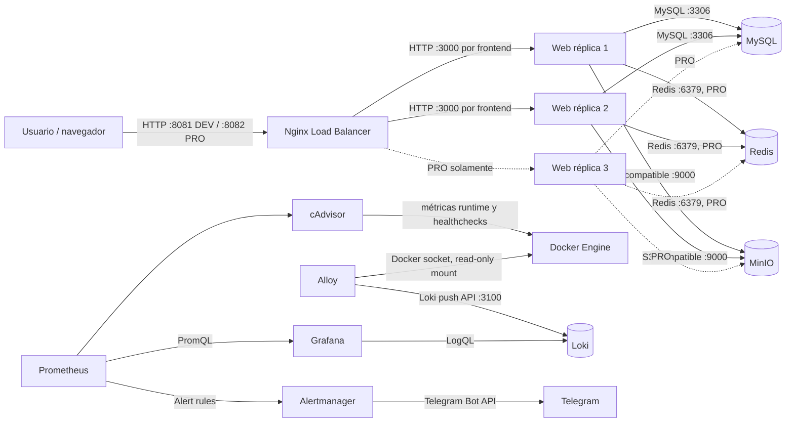
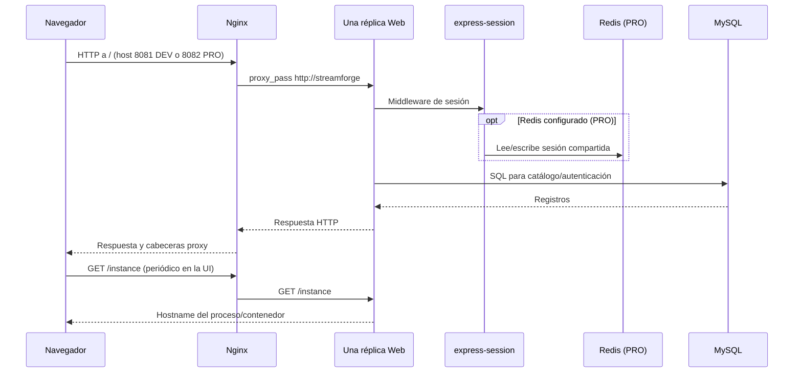
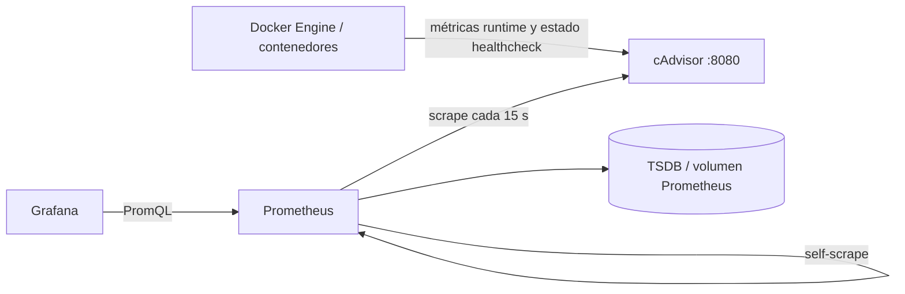
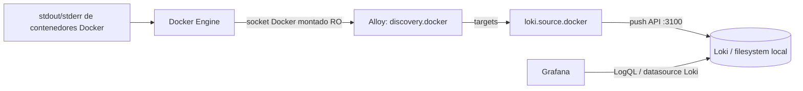
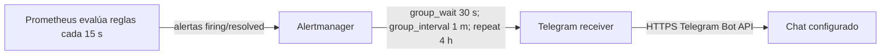
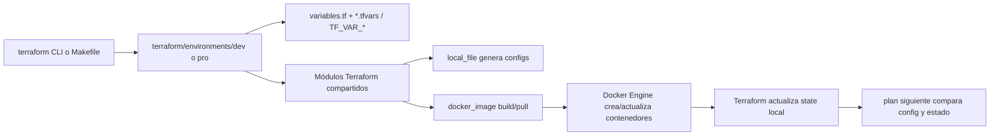

# Auditoría técnica de StreamForge — Práctica 2

**Fecha de revisión:** 25 de noviembre de 2026
**Alcance:** configuración y código presentes en el worktree de esta revisión, más una observación de solo lectura del Docker local. No se han ejecutado `terraform apply`, destrucciones, reinicios ni pruebas que detengan servicios.
**Uso previsto:** documento base para preparar y defender una ponencia universitaria sobre Infrastructure as Code.

> **Cómo leer la evidencia**
>
> - **Configurado en código** significa que existe en los archivos Terraform o de aplicación indicados; no demuestra por sí solo que se haya aplicado.
> - **Observado en ejecución** identifica una comprobación de solo lectura en Docker, Prometheus o Loki durante esta revisión. Es una instantánea, no una garantía de disponibilidad futura.
> - **Deducción** identifica un resultado inferido del orden del código o de la arquitectura, no una prueba de fallo inducido.
> - Las credenciales y valores de secretos se omiten. Las variables se citan solo por su nombre.
> - Las referencias a líneas usan enlaces relativos al repositorio. Los archivos generados pueden cambiar al ejecutar Terraform.

## 1. Resumen ejecutivo

StreamForge es una aplicación web Node.js desplegada como contenedores Docker mediante Terraform. Terraform define dos roots independientes, DEV y PRO, que reutilizan módulos para redes, MySQL, MinIO, aplicación, balanceador y monitorización. No se encontró una configuración Docker Compose. El Makefile automatiza principalmente DEV; PRO se opera directamente con Terraform.

La ruta normal de una petición es **cliente → Nginx → una réplica web**. La aplicación usa MySQL para usuarios, catálogo y metadatos de vídeo; Redis se configura en PRO para sesiones compartidas y caché. Los objetos multimedia se guardan en MinIO, y la aplicación los sirve a través de rutas autenticadas. DEV configura dos réplicas y no habilita Redis. PRO configura tres réplicas, Redis y puertos distintos para coexistir con DEV.

La telemetría tiene dos pipelines:

- **Métricas:** Prometheus consulta cada 15 segundos su propio endpoint, cAdvisor y Alertmanager en PRO. cAdvisor aporta CPU, memoria, red, OOM, healthchecks Docker y métricas de filesystem por contenedor; no proporciona el uso total del filesystem raíz del host.
- **Logs:** Alloy descubre contenedores usando el socket Docker montado en solo lectura y envía los logs a Loki. Grafana consulta Loki. La configuración actual no contiene reglas explícitas de transformación o de mapeo de nombres de servicio.

El dashboard mezcla métricas y logs. En la lectura local anterior a aplicar esta refactorización, `container_last_seen` y `container_health_state` sí tenían labels `name` con prefijo de entorno; los servicios con healthcheck estaban sanos. cAdvisor ve contenedores de ambos entornos en el Docker Engine compartido, por lo que los filtros de entorno son necesarios. Se observó el valor Loki `service_name="unknown_service"`, que coincide con los selectores de logs del dashboard, pero Alloy no asigna explícitamente ese label.

Las reglas de alertas se definen en un template Prometheus y Alertmanager envía a Telegram tanto activaciones como resoluciones. En PRO se configura el job de scrape `alertmanager`. La configuración y un procedimiento de prueba existen, pero esta auditoría no valida la entrega a Telegram.

La cantidad de réplicas Web y el reintento de Nginx aportan tolerancia a fallos de instancias de aplicación, pero no constituyen alta disponibilidad integral: MySQL, Redis, MinIO, Nginx y varios componentes de monitorización son instancias únicas. DEV y PRO se observaron ejecutándose localmente; la monitorización que está desplegada todavía no incorpora esta refactorización porque no se ha aplicado.

## 2. Arquitectura global

Los nombres de contenedor usan el prefijo del entorno, por ejemplo `dev_web_1` y `pro_web_1`. La configuración de redes, servicios y puertos se parametriza en cada root de entorno y se implementa en módulos compartidos.

### Diagrama 1 — arquitectura general



La línea punteada del tercer Web replica y Redis representa elementos configurados solo en PRO. El diagrama no implica que PRO esté desplegado en el host observado.

### Diagrama 2 — flujo de petición de usuario



El balanceador habla HTTP dentro de la red `frontend`. El endpoint `/instance` informa el hostname del proceso que atendió esa solicitud; la UI lo consulta cada tres segundos. No es un identificador de despliegue configurado aparte.

### Diagrama 3 — pipeline de métricas



### Diagrama 4 — pipeline de logs



### Diagrama 5 — pipeline de alertas



Las duraciones `for` pertenecen a cada regla y retrasan su transición a firing; la agrupación y las repeticiones son comportamiento de Alertmanager.

### Diagrama 6 — almacenamiento y reproducción de vídeo

```mermaid
sequenceDiagram
    participant Admin as Administrador / uploader
    participant Silo as MinIO (Silo)
    participant DB as MySQL
    participant UI as Navegador + dash.js
    participant App as Web /video/stream
    Admin->>Silo: Sube manifest.mpd y .m4s a buckets separados
    Admin->>DB: Registra metadatos del vídeo (paso separado)
    UI->>App: GET /api/videos/:id
    App->>DB: Lee mpdPath y metadatos
    DB-->>UI: MPD path del catálogo
    UI->>App: Solicita /video/stream/<MPD>
    App->>Silo: Lee manifest en bucket de manifests
    Silo-->>UI: MPD por respuesta autenticada de App
    UI->>App: Solicita segmentos .m4s referenciados
    App->>Silo: Lee chunks; soporta byte ranges
    Silo-->>UI: Segmentos servidos por App
```

La aplicación puede servir localmente ciertos casos de fallback, descritos en el apartado 16; el diagrama muestra la ruta principal de objetos almacenados en MinIO.

## 3. Mapa completo de componentes

| Componente | Función y recurso | Imagen/configuración | Puertos y redes | Datos, dependencias y efecto de caída |
|---|---|---|---|---|
| Web | API y frontend; `${env}_web_N`, `count = replicas` | Imagen construida desde `app/` con `app/Dockerfile` | App escucha `3000`; solo red `frontend` y `backend`; sin puerto host propio | Recibe HTTP de Nginx; usa MySQL, MinIO y, en PRO, Redis. Si una réplica cae, Nginx puede reintentar otra; si todas caen, la web no está disponible. |
| Nginx Load Balancer | Entrada HTTP y proxy a upstream `streamforge` | `nginx:alpine`; config generada por `local_file.nginx_config` | `80` interno; host `8081` DEV / `8082` PRO; `frontend` | Recibe todas las peticiones de usuario. Si cae, las réplicas no tienen entrada pública alternativa configurada. |
| MySQL | Usuarios, catálogo, categorías y estado relacional | `mysql:8.0`; [init.sql](db/init.sql) | `3306`, red `backend`, sin bind host | Web depende de conexión y consultas. Caída impide operaciones de aplicación que requieren BD; inicio de Web espera MySQL y puede salir tras agotarse los reintentos. Volumen nombrado por entorno. |
| Redis | Sesiones compartidas y caché en PRO | `redis:7-alpine`; sin persistencia declarada en el módulo | `6379`, red `backend`, sin bind host | Web usa Redis para sesiones cuando `REDIS_HOST` está configurado. Caída puede bloquear middleware de sesión. El caché de vídeo tiene fallback a MySQL en ciertos errores Redis; la ruta `/services` no tiene el mismo fallback. |
| MinIO / Silo | Almacenamiento de manifiestos y chunks multimedia | Imagen `streamforge-silo:${env}`, build desde `terraform/modules/storage/` | API `9000`, consola `9001`; backend + host-storage | Web accede al API dentro de Docker. Datos bajo volumen `/data`; `media/` del repo se monta RO en `/media`. Si cae, los streams de objetos fallan salvo el fallback local específicamente implementado. |
| Prometheus | Scrape, TSDB y evaluación de reglas | `prom/prometheus:latest` (default del módulo); template `prometheus.yml.tftpl` | `9090` interno; bind host localhost; monitoring + host-monitoring | Scrapea cAdvisor y a sí mismo; en PRO también scrapea Alertmanager. Almacena en volumen `/prometheus` y envía alertas a Alertmanager. Caída elimina scrape/evaluación mientras dure. |
| Grafana | Dashboards y consulta de fuentes | `grafana/grafana:latest` | `3000` interno → localhost `3001` DEV / `3002` PRO; monitoring + host-monitoring | Consulta Prometheus y Loki. Si cae, la telemetría sigue almacenándose, pero no se visualiza por esta UI. |
| cAdvisor | Métricas de Docker/contenedores | `gcr.io/cadvisor/cadvisor:latest`; CPU/memory/network/OOM/disk; Docker-only | `8080`, monitoring, no host port | Lee `/sys`, sockets Docker/containerd en RO y expone métricas para Prometheus. `container_fs_usage_bytes` y `container_fs_limit_bytes` describen filesystem por contenedor, no capacidad total/libre del host. |
| Healthchecks de Docker | Estado de aplicación/servicio dentro del contenedor | Healthchecks declarados en Web, Nginx, MySQL, MinIO y Redis | No añaden puertos ni servicios | cAdvisor exporta `container_health_state`: `1` sano, `0` no sano, `-1` desconocido. No prueba la reachability desde una red externa. |
| Métricas HTTP de Nginx | Requests y distribución por upstream | No hay instrumentación dedicada | No existe target/job | cAdvisor puede informar healthcheck y recursos del contenedor, pero no requests ni distribución por upstream. |
| Alloy | Descubrimiento y recolección de logs Docker | `grafana/alloy:latest`; `config.alloy` | HTTP interno `12345`, sin host bind; monitoring; socket Docker RO + grupo suplementario | Descubre contenedores y lee logs; escribe en Loki. Si cae, se interrumpe nueva ingesta desde Docker; los logs históricos en Loki permanecen según almacenamiento/retención. |
| Loki | Almacenamiento y consulta de logs | `grafana/loki:latest`; `loki.yml` | `3100`, monitoring, sin host bind | Recibe push de Alloy, almacena filesystem/TSDB en volumen. Si cae, Alloy no entrega logs y Grafana no puede consultar. |
| Alertmanager | Agrupación, deduplicación y notificación | `prom/alertmanager:latest` | `9093`, monitoring + frontend para salida Telegram; sin host bind | Recibe alertas de Prometheus, agrupa y llama Telegram. Si cae, Prometheus puede evaluar alertas, pero la notificación externa no funciona. |
| Docker API en Alloy | Interfaz de control/lectura usada por discovery | Socket del host `/var/run/docker.sock` montado RO | Solo visible dentro del contenedor Alloy | El proxy separado fue eliminado para simplificar. El socket es un límite de confianza elevado; mount RO no restringe operaciones API. |
| Terraform | Define redes, imágenes, contenedores, volúmenes y ficheros locales | Providers Docker y Local | Ejecutado desde host; no es un servicio contenedor | Estado local por root de entorno. Reemplazos y cambios dependen del plan; `apply` es necesario para modificar Docker. |
| Makefile / scripts | Atajos de operación, preparación de medios y carga | Makefile root, `dash.sh`, `app/scripts/upload-video.js`, `init-buckets.sh` | Comandos locales | Makefile cubre DEV; el uploader manual no sustituye el registro del catálogo en MySQL. |
| Docker Compose | Orquestación alternativa | **No hay archivo Compose localizado** | — | El despliegue documentado es Terraform + Docker provider. |

Rutas de definición detalladas: [módulo web](terraform/modules/web/main.tf#L11), [base de datos](terraform/modules/database/main.tf#L1), [cache](terraform/modules/cache/main.tf#L1), [storage](terraform/modules/storage/main.tf#L1), [load balancer](terraform/modules/load_balancer/main.tf#L5) y [monitoring](terraform/modules/monitoring/main.tf#L82).

## 4. Redes y comunicaciones

Las redes creadas por Terraform son bridges Docker sin subredes/IPAM explícitamente fijados. Docker asigna direcciones automáticamente.

| Red | `internal` | Miembros/uso definido |
|---|---:|---|
| `${env}_frontend` | false | Nginx, Web y Alertmanager para salida Telegram. |
| `${env}_backend` | true | MySQL, Redis cuando existe, Web y MinIO. |
| `${env}_monitoring` | true | Prometheus, Grafana, Loki, Alloy, cAdvisor y Alertmanager en PRO. |
| `${env}_host_storage` | false | MinIO, para activar el bind local a sus puertos. `com.docker.network.bridge.enable_ip_masquerade=false`. |
| `${env}_host_monitoring` | false | Prometheus y Grafana, con masquerading deshabilitado. |

Web conecta `frontend` y `backend`: Nginx la alcanza por la primera y los servicios de datos por la segunda. MySQL y Redis no se conectan a redes host-access. Grafana y Prometheus conservan `monitoring` y añaden la red host-monitoring; MinIO conserva `backend` y añade host-storage. Así los puertos publicados siguen ligados a `127.0.0.1`, y no se hace público el puerto de los servicios backend.

Los binds configurados:

| Servicio | Host | Contenedor | Acceso |
|---|---:|---:|---|
| Load Balancer DEV / PRO | `8081` / `8082` | `80` | `0.0.0.0` en configuración actual |
| MinIO DEV | `9000`, `9001` | `9000`, `9001` | `127.0.0.1` |
| MinIO PRO | `9100`, `9101` | `9000`, `9001` | `127.0.0.1` |
| Grafana DEV / PRO | `3001` / `3002` | `3000` | `127.0.0.1` |
| Prometheus DEV / PRO | `9090` / `9091` | `9090` | `127.0.0.1` |
| MySQL, Redis, Loki, Alloy, Alertmanager y Web | ninguno | puertos internos | Solo redes Docker |

La política equivalente en cloud no consiste en trasladar literalmente bridges Docker. En una VPC se usarían subnets/route tables y Security Groups con reglas de origen explícitas: Internet → Load Balancer solamente; LB → Web; Web → MySQL/Redis/MinIO según puertos necesarios; administración → Grafana/Prometheus desde red confiable; endpoints de métricas de cAdvisor y Alertmanager accesibles solo desde Prometheus; salida a Telegram solo desde Alertmanager. Network ACLs/firewall pueden aportar una capa adicional. El README advierte que el aislamiento Docker local no sustituye controles de host o de cloud.

**Límite actual:** una red Docker no es un firewall por servicio con reglas L3/L4 explícitas. Las redes `host_*` no son `internal`; el bind localhost limita la publicación del puerto en el host, pero su creación implica una interfaz Docker adicional que hay que revisar en el host concreto.

## 5. Terraform e Infrastructure as Code

### 5.1 Estructura

- Roots independientes: [DEV](terraform/environments/dev/main.tf) y [PRO](terraform/environments/pro/main.tf).
- Módulos comunes: `terraform/modules/{network,database,cache,storage,web,load_balancer,monitoring}`.
- Configuración generada por `local_file`: Prometheus, alert rules, Alloy, Loki, datasources Grafana, Alertmanager y Nginx.
- El código Terraform crea redes Docker, volúmenes Docker, imágenes, contenedores y archivos locales generados. No crea una VPC, una VM/host Docker, un servicio gestionado cloud ni el bot de Telegram.

### 5.2 Providers, estado y variables

Los roots requieren Terraform `>= 1.5.0`, Docker provider `~> 3.0` y Local provider `~> 2.5`. Los lockfiles fijan versiones concretas de providers. No hay un bloque `backend`; Terraform usa backend local. DEV y PRO mantienen sus estados bajo sus directorios de entorno, por lo que la separación de roots evita mezclar el estado.

Variables sensibles relevantes: contraseñas MySQL y MinIO, `grafana_password`, `session_secret`, `telegram_bot_token` y `telegram_chat_id`. En código aparecen como variables/valores interpolados, no deben copiarse a esta documentación. DEV usa un `dev.tfvars` local ignorado por Git; PRO incluye `pro.tfvars.example` y el `pro.tfvars` real se crea localmente. Terraform state debe protegerse: el provider Docker puede registrar configuración sensible del contenedor, incluidos valores de entorno.

### 5.3 Dependencias y aplicación

El orden se expresa mediante referencias implícitas (por ejemplo, usar el ID/imagen de otro recurso) y `depends_on` explícitos. Ambos roots crean la red antes de servicios; Web depende de BD y storage, y también de cache en PRO; el Load Balancer depende de Web. En monitoring, Prometheus depende de cAdvisor y Alloy depende de Loki.

Flujo real de despliegue:



Un cambio en un template o `local_file` puede provocar un cambio/reemplazo del contenedor que lo monta, según el provider y el recurso afectado. Un cambio en variables de puertos, redes o imagen también puede requerir recreación. No se debe inferir el efecto solo leyendo el diff: el plan es la evidencia del lifecycle que Terraform propone. El cambio previo de binds en redes `internal=true` mostró que la configuración del puerto podía aparecer en `HostConfig` sin binding runtime; las redes host-access añadidas resuelven ese caso.

Las imágenes de aplicación y Silo se construyen desde contextos locales Terraform; imágenes de servicios de monitorización se referencian por tag remoto, varios `latest`. Cambiar contenido de contexto/configuración no significa necesariamente que todo se reconstruya; hay que revisar el recurso `docker_image` y planificar el reemplazo del contenedor.

### 5.4 Qué queda fuera

Terraform gestiona los recursos declarados en los roots. El daemon Docker y host Linux, la disponibilidad de DNS/Internet, Telegram/BotFather, el navegador del usuario, y el contenido local de `media/` son dependencias externas. No se encontró Compose. El archivo SQL de inicialización se monta en MySQL y el script del storage inicializa buckets en el arranque; esos son mecanismos de contenedor, no servicios cloud creados por Terraform.

### 5.5 Estado observado y cautelas

En la instantánea del host había contenedores DEV en ejecución; no se observaron servicios `pro_*`. La configuración PRO es evidencia de intención/configuración, no de despliegue actual. El estado local no sustituye `docker ps` como evidencia de ejecución y `docker ps` no sustituye el state para conocer lo que Terraform cree administrar.

El worktree tenía modificaciones previas en README/Terraform y el archivo `terraform/environments/dev/tfplan` estaba modificado. No se debe tratar ese plan binario como texto ni sobrescribirlo sin decisión del usuario. Además, el Makefile escribe `tfplan`, mientras que `.gitignore` ignora `*.tfplan`; el archivo llamado exactamente `tfplan` no coincide con esa regla.

## 6. DEV vs PRO: diferencias configuradas

| Propiedad | DEV | PRO |
|---|---|---|
| Root/state Terraform | `terraform/environments/dev` | `terraform/environments/pro` |
| Réplicas Web | 2 | 3 |
| Imagen aplicación | `streamforge-dev` | `streamforge-pro` |
| Redis | No se instancia; `cache_enabled=false`; sin `REDIS_HOST` | Redis 7 Alpine; `REDIS_HOST` y `REDIS_PORT` |
| Demo seed de usuarios | `SEED_DEMO_USERS=true` | `SEED_DEMO_USERS=false` |
| Load Balancer | host `8081` → `80` | host `8082` → `80` |
| MinIO | host `9000/9001` → container `9000/9001` | host `9100/9101` → container `9000/9001` |
| Grafana | host `3001` → container `3000` | host `3002` → container `3000` |
| Prometheus | host `9090` → container `9090` | host `9091` → container `9090` |
| Réplicas Web | 2 | 3 |
| Volúmenes | Nombres prefijados `dev_` | Nombres prefijados `pro_` |
| Redes | `dev_*` | `pro_*` |
| Alertas cache | Redis omitido | Redis habilitado |
| Salidas Terraform | IDs de red | URLs para app, Grafana, Prometheus y MinIO |
| Despliegue observado en esta revisión | Contenedores activos | No se observó `pro_*` activo |

Los prefijos de nombres, redes y volúmenes separan los recursos y los puertos publicados evitan colisiones. Esa separación permite desplegarlos simultáneamente **si** se aplican ambos roots con valores/secretos válidos y no existe otro proceso usando sus puertos. El código por sí solo no prueba que puedan coexistir sin conflictos en cualquier host.

## 7. Aplicación web, MySQL y Redis

### 7.1 Aplicación

La imagen usa Node.js (no Python/Flask): [Dockerfile](app/Dockerfile) expone `3000`; Terraform construye desde `app/`. En el backend, [app.js](app/src/app.js#L16) registra middleware y rutas de autenticación, vídeos, administración, streaming, salud e instancia.

Variables de entorno configuradas para Web:

| Grupo | Nombres configurados |
|---|---|
| MySQL | `MYSQL_HOST`, `MYSQL_PORT`, `MYSQL_USER`, `MYSQL_PASSWORD`, `MYSQL_DATABASE` |
| Sesión / demo | `SESSION_SECRET`, `COOKIE_SECURE`, `SEED_DEMO_USERS` |
| MinIO | `MINIO_ENDPOINT`, `MINIO_ACCESS_KEY`, `MINIO_SECRET_KEY` |
| Redis, PRO solamente | `REDIS_HOST`, `REDIS_PORT` |

El listener de la aplicación es el puerto 3000 del contenedor. DEV define dos contenedores desde la misma imagen/config base; PRO define tres. El endpoint de instancia se registra antes del middleware de sesión, por lo que su respuesta no depende de Redis.

| Ruta | Función / protección |
|---|---|
| `GET /health` | Estado de MySQL/cache; usado por los healthchecks Docker de Web y Load Balancer. |
| `GET /instance` | Devuelve `os.hostname()`, antes del middleware de sesión. |
| `GET /api/videos` | Catálogo, filtros y búsqueda. |
| `GET /api/videos/:id` | Detalle de vídeo, requiere sesión. |
| `/api/admin/*` | Operaciones de administración; exige sesión admin. |
| `/video/stream/*` | Sirve manifest/chunks y requiere autenticación. |

La UI [instance.js](app/public/js/instance.js) consulta `/instance` cada 3 s y lo muestra en el catálogo y el reproductor. El balanceador no pasa un índice explícito; la respuesta se identifica por hostname del contenedor.

### 7.2 MySQL

[`database/main.tf`](terraform/modules/database/main.tf#L1) usa `mysql:8.0`, variables de nombre de BD/usuario/password y volumen `${environment}_mysql_data` en `/var/lib/mysql`; el contenedor se conecta a backend y no publica puerto host. [`db/init.sql`](db/init.sql#L2) define `services`, `users`, `categories`, `videos` y `view_history` e inserta datos iniciales de servicios/categorías; no crea videos de ejemplo según el SQL revisado.

La aplicación crea un pool desde `MYSQL_HOST`, `MYSQL_PORT`, `MYSQL_USER`, `MYSQL_PASSWORD` y `MYSQL_DATABASE` en [db.js](app/src/db.js#L1). Al arrancar, intenta conectar hasta 30 veces con pausas de 2 segundos y termina el proceso si no conecta; la semilla de usuarios también precede al listener.

### 7.3 Redis y cache

DEV no crea Redis y la app se configura sin `REDIS_HOST`. PRO configura Redis como servicio único en [`cache/main.tf`](terraform/modules/cache/main.tf#L1) y lo conecta solo a backend. Con `REDIS_HOST`, express-session usa Redis con prefijo `streamforge:sess:` para compartir sesiones entre réplicas. Sin Redis, queda el MemoryStore por defecto de express-session; no es adecuado como persistencia/compartición HA entre procesos.

Cache de vídeos implementada en [`cache.js`](app/src/cache.js#L14) y usada en rutas de catálogo:

- Claves: `videos:all`, `videos:search:<search>:category:<category>` y `videos:<id>`.
- TTL de 60 s.
- La capa `getCached` tolera errores de Redis durante lectura/escritura y consulta MySQL como fallback.
- Las mutaciones administrativas invalidan claves `videos:*`; el error de invalidación se registra y se absorbe.

La ruta `/services` usa otra clave `services` con 60 s y no comparte exactamente el fallback de vídeos. Si Redis está configurado y falla la conexión de sesión global, las rutas posteriores pueden no alcanzar su fallback individual. Es una deducción del orden del middleware, no una prueba con Redis detenido.

## 8. Balanceador: algoritmo y tolerancia a fallos

[`load_balancer/main.tf`](terraform/modules/load_balancer/main.tf#L5) crea un fichero Nginx por entorno: un `upstream streamforge` con un `server <web>:3000` por elemento de `web_containers`, y un `server` escuchando en 80 con `proxy_pass http://streamforge`.

No se declara `least_conn`, `ip_hash` ni otro algoritmo; el comportamiento de Nginx upstream es **round robin por defecto**. La configuración incluye:

```nginx
proxy_next_upstream error timeout http_502 http_503 http_504;
proxy_next_upstream_tries <número de Web configuradas>;
```

Por tanto, Nginx puede reintentar otra upstream ante error de conexión, timeout y respuestas 502/503/504. No se configuran `max_fails` ni `fail_timeout` explícitos en el upstream. El healthcheck Docker consulta `/health` cada 15 s, timeout 5 s, tres retries y start period 90 s; como la ruta cae en la location proxy, es un chequeo del camino HTTP del balanceador hacia Web, no un chequeo aislado del proceso Nginx.

**Least Connections hipotético:** se cambiaría el bloque `upstream streamforge` en `terraform/modules/load_balancer/main.tf`, añadiendo `least_conn;`. El algoritmo seleccionaría la upstream con menos conexiones activas, en vez de rotar solicitudes. Para demostrarlo sin detener servicios, se podría generar carga concurrente controlada y comparar la distribución por hostname/requests; actualmente no se recopilan métricas de requests por upstream. cAdvisor no las proporciona; la UI `/instance` ayuda a observar qué réplica respondió, pero una muestra manual no demuestra equilibrio estadístico.

## 9. Pipeline de métricas

### 9.1 Prometheus

El fichero fuente es [`prometheus.yml.tftpl`](terraform/modules/monitoring/prometheus.yml.tftpl#L1); Terraform lo renderiza a `terraform/environments/<env>/generated/prometheus.yml`. Configura `scrape_interval: 15s` y `evaluation_interval: 15s`, sin intervalos específicos por job.

Jobs:

| Job | Target | Qué obtiene |
|---|---|---|
| `prometheus` | `${env}_prometheus:9090` | Métricas del propio Prometheus. |
| `cadvisor` | `${env}_cadvisor:8080` | Métricas cAdvisor. |
| `alertmanager` | `${alertmanager_target}` (solo PRO) | Disponibilidad del Alertmanager. |

Se eliminaron las consultas de probes HTTP/TCP. La disponibilidad ahora se deriva de Docker healthchecks observados por cAdvisor y de la presencia/frescura de contenedores. Una muestra `container_last_seen` de más de 45 s se considera obsoleta; después se respeta el `for` configurado en cada alerta. Los healthchecks están definidos dentro de los módulos de aplicación y datos; no validan la conectividad desde fuera del contenedor ni proporcionan latencia de probe.

Los samples de Prometheus quedan en el volumen `${env}_prometheus_data` montado en `/prometheus`. No se localizó un flag explícito de retención (`--storage.tsdb.retention.time` o `size`); por tanto, aplica el default de la versión de Prometheus utilizada, y el plazo efectivo debe verificarse en runtime. No se debe presentar una retención fijada en Terraform.

### 9.2 cAdvisor y origen de métricas

**cAdvisor:** `--docker_only=true`, métricas CPU/memoria/network/OOM/disk, housekeeping 15 s y `--store_container_labels=false`. El intervalo de Prometheus también es 15 s, pero es una configuración separada. cAdvisor lee runtime/host y expone `/metrics` en 8080. CPU (`container_cpu_usage_seconds_total`), memoria (`container_memory_working_set_bytes`), health (`container_health_state`) y OOM (`container_oom_events_total`) se observaron en los dos Prometheus. El colector `disk` añade `container_fs_usage_bytes` y `container_fs_limit_bytes`, que miden el filesystem de cada contenedor; no agregan todo el uso del filesystem raíz del host ni garantizan incluir datos de volúmenes montados.

La métrica observada `container_health_state` vale `1` para healthcheck sano, `0` para fallido y `-1` cuando el estado es desconocido/no hay healthcheck. Las alertas comparan con `0`; no convierten `-1` en caída. Las consultas existentes devolvieron labels `name` para los contenedores con prefijos `dev_` y `pro_`; cada cAdvisor puede ver ambos grupos porque accede al mismo Docker Engine.

**Healthchecks Docker:** Web consulta HTTP `/health`; el balanceador consulta `/health` a través de su proxy; MinIO consulta su endpoint readiness; MySQL ejecuta `SELECT 1`; Redis ejecuta `PING`. cAdvisor lee su estado, pero no sustituye pruebas de conectividad externas ni mide latencia del servicio.

**Métricas HTTP de Nginx:** no hay instrumentación de requests por upstream/estado HTTP; la métrica de healthcheck no aporta esas series.

**Clasificación importante:**

- **Métrica de componente:** cAdvisor expone muestras; Prometheus las scrapea.
- **Métrica self-scrape:** `up` y series propias de Prometheus.
- **Métrica calculada en PromQL:** por ejemplo CPU porcentual o porcentaje filesystem.
- **Consulta de dashboard/alerta:** PromQL no crea la métrica de origen; agrega/filtra muestras ya almacenadas.

### 9.3 Labels y compatibilidad real del dashboard

El dashboard usa labels `name`, `id`, `cpu`, `instance`, `job`, `service`, y labels de alertas. Deben comprobarse con `/api/v1/series` o `/api/v1/query`, no suponerse por nombre del contenedor.

En la lectura de solo lectura anterior a aplicar esta refactorización, DEV reportó 9 targets `UP` y PRO 12, incluidos los jobs y probes que se eliminan del código. El nuevo template declara 2 targets en DEV (`prometheus`, `cadvisor`) y 3 en PRO (los anteriores y `alertmanager`). No se ha ejecutado `terraform apply`: el Docker local todavía conserva la configuración y contenedores anteriores hasta desplegar los cambios.

La API actual devuelve 27 series `container_last_seen` con label `name` de ambos entornos. `container_health_state` mostró las Web, el balanceador, MySQL, MinIO y Redis sanos (`1`); servicios sin healthcheck dieron `-1`. CPU/RAM de host (`id="/"`) y eventos OOM también existen. `container_fs_usage_bytes`/`container_fs_limit_bytes` no aparecen en la configuración ejecutada porque el colector `disk` aún no estaba habilitado durante la observación; el código ahora lo habilita. El filesystem raíz del host se obtenía antes de una fuente separada y ya no estará disponible tras retirarla.

### 9.4 Paneles y PromQL existentes

El dashboard provisionado está en `terraform/modules/monitoring/grafana/dashboards/streamforge-infrastructure.json`.

| Panel | Consulta configurada | Nota |
|---|---|---|
| Prometheus / cAdvisor target | `up{job="cadvisor"}` | Salud del scrape target, no número de contenedores. |
| Monitored containers | `count(container_last_seen{...} and on (name) (time() - container_last_seen{...} < 45))` | Cuenta muestras frescas; Terraform sustituye el placeholder de entorno. |
| Host CPU | `sum(rate(container_cpu_usage_seconds_total{id="/",cpu="total"}[5m])) / scalar(machine_cpu_cores) * 100` | Cálculo basado en raíz host/cgroup. |
| Host RAM % | `container_memory_working_set_bytes{id="/"} / on(instance,job) machine_memory_bytes * 100` | División de muestras por labels coincidentes. |
| Container CPU | `sum by (name) (rate(container_cpu_usage_seconds_total{name=~"^__ENVIRONMENT___.+",name=~"${container:regex}",name!="",cpu="total"}[5m])) / scalar(machine_cpu_cores) * 100` | Requiere `name`; normalizado sobre la capacidad total del host. |
| Container RAM | `max by (name) (container_memory_working_set_bytes{name=~"^__ENVIRONMENT___.+",name=~"${container:regex}",name!=""}) / 1000000000` | Requiere `name`. |
| Docker healthcheck | Estado por `name` solo si `time() - container_last_seen < 45`; muestras obsoletas se presentan como `-1` | `1` sano, `0` no sano, `-1` desconocido/obsoleto. |
| OOM | `sum by (name) (increase(container_oom_events_total{name=~"^__ENVIRONMENT___.+",name!=""}[$__range])) or on (name) (0 * max by (name) (container_last_seen{name=~"^__ENVIRONMENT___.+",name!=""}))` | Muestra cero para contenedores actualmente vistos cuando no hay eventos en el rango. |
| Active Prometheus alerts | `ALERTS{alertstate="firing"}` | Series generadas por reglas firing. |
| Service Docker healthchecks | `container_health_state` filtrado a muestras frescas; obsoletas se presentan como `-1` | Terraform sustituye el entorno; no es una prueba externa. |
| Available Web replicas | Suma healthchecks `== 1` únicamente si `time() - container_last_seen < 45` | Cuenta réplicas sanas y observadas recientemente; no prueba reachability desde usuarios. |
| Container filesystem limit used | `100 * sum by (name) (container_fs_usage_bytes{name=~"^__ENVIRONMENT___.+",name=~"${container:regex}",name!=""}) / on (name) sum by (name) (container_fs_limit_bytes{name=~"^__ENVIRONMENT___.+",name=~"${container:regex}",name!=""} > 0)` | Porcentaje agregado por contenedor sobre los límites de filesystem reportados por cAdvisor; no equivale al filesystem raíz del host. |

El dashboard tiene además tres paneles LogQL, detallados en el apartado 11. La variable `container` usa `label_values(container_last_seen{name=~"^__ENVIRONMENT___.+",name!=""}, name)`; Terraform reemplaza el placeholder por el entorno correspondiente, así que DEV y PRO usan el mismo selector parametrizado.

### 9.5 Añadir una métrica (procedimiento hipotético)

1. Comprobar primero si cAdvisor o una métrica ya scrapeada cubre el requisito, y verificarla mediante `/api/v1/query` y sus labels reales.
2. Para disponibilidad de contenedores, comprobar que exista un Docker healthcheck adecuado y que cAdvisor emita `container_health_state`; no tratar `up` o un contenedor en ejecución como prueba HTTP externa.
3. Si la métrica no existe, documentar la limitación; añadir instrumentación o servicios queda fuera de esta refactorización y requiere una decisión explícita independiente.
4. Construir PromQL con métricas y labels verificados; parametrizar el entorno en vez de hardcodear `dev`.
5. Si se cambia configuración existente, validar Terraform y YAML con `promtool`, comprobar `/api/v1/targets` y probar las consultas antes de desplegar.
6. Añadir o adaptar el panel en el JSON y revisar su datasource UID.
7. Validar visualmente en Grafana y comparar el resultado con la fuente observada.

Para requests HTTP por instancia no hay métricas disponibles en el código actual. El colector `disk` permite calcular porcentajes y diferencias de uso/límite por filesystem de contenedor, pero no restaura el porcentaje, capacidad ni espacio libre total del filesystem raíz del host.

## 10. Pipeline de logs

### 10.1 Origen y Alloy

Los logs recogidos son logs de contenedores a través de la API de Docker; no se encontraron mounts de ficheros de log de aplicación en Alloy. El flujo está en `terraform/modules/monitoring/config.alloy`:

1. `discovery.docker "containers"` conecta con `unix:///var/run/docker.sock` en [`config.alloy`](terraform/modules/monitoring/config.alloy#L1).
2. Usa targets descubiertos por Docker.
3. `loki.source.docker "containers"` obtiene los logs de esos targets.
4. `forward_to` envía las entradas a `loki.write.default.receiver`.
5. `loki.write` apunta a `http://${environment}_loki:3100/loki/api/v1/push`.

No hay un bloque explícito de `loki.process`, relabeling o mapeo de contenedor a `service_name` en ese archivo. La configuración exacta no declara filtros de logs por servicio. El contenedor Alloy usa el usuario `alloy`, el grupo suplementario cuyo GID se configura mediante `docker_socket_gid` (default 126 en este host/module), y monta `/var/run/docker.sock` con `read_only=true`.

**Seguridad:** el montaje RO evita modificar el objeto filesystem por esa ruta, pero la API Docker expuesta por el socket es potente y no queda convertida en API de solo lectura. El proxy dedicado se eliminó para simplificar. Alloy no tiene puerto host, pero su acceso al socket aumenta el impacto potencial de una vulneración. El GID debe comprobarse en cada host (`stat -c '%g' /var/run/docker.sock`).

No existe un intervalo Prometheus para logs: Alloy usa la fuente Docker/tailing; la config no especifica `scrape_interval` ni una frecuencia de batch propia.

### 10.2 Loki y labels observados

Loki corre en modo de un solo proceso/local, con autenticación desactivada y almacenamiento filesystem/TSDB según `terraform/modules/monitoring/loki.yml`; `/loki` se guarda en volumen nombrado. No se encontró una política de retención explícita en la config revisada. El endpoint de push interno es 3100 y no se publica al host.

El dashboard consulta:

```logql
{service_name="unknown_service"}
{service_name="unknown_service"} |= "level=error"
{service_name="unknown_service"} |= "[DASH]" !~ "caller="
```

En una consulta de solo lectura a la API de Loki durante esta revisión, el label disponible fue `service_name` y el valor consultado fue `unknown_service`; además, una entrada reciente de un request de prueba apareció en Loki. Esto valida que la ruta de logs funciona en ese momento, pero no significa que Alloy asigne deliberadamente ese valor ni que sea una taxonomía útil por servicio. El selector `unknown_service` es compatible con el valor observado, aunque no distingue contenedores.

### 10.3 Grafana, datasources y consulta

El datasource Prometheus se provisiona como default y el datasource Loki como secundario mediante `local_file` montados en Grafana. El dashboard JSON referencia UID Prometheus `PBFA97CFB590B2093` y Loki `P8E80F9AEF21F6940`; los snippets de provisioning revisados configuran nombre/tipo/URL, pero no fijan explícitamente esos UIDs. Esa diferencia es un riesgo de desajuste entre dashboard y datasource que debe comprobarse en la UI/API de Grafana tras provisionar.

Ejemplos LogQL:

- Todos los logs seleccionados: `{service_name="unknown_service"}`
- Errores que contienen `level=error`: `{service_name="unknown_service"} |= "level=error"`
- Eventos DASH: `{service_name="unknown_service"} |= "[DASH]" !~ "caller="`

No hay en la config actual label `container_name` garantizado por el dashboard. Para localizar un contenedor concreto primero hay que consultar `/loki/api/v1/labels` y `/loki/api/v1/label/<label>/values`, inspeccionar un stream real y usar solo labels observados. No inventar `container`, `service_name` ni `job`.

### 10.4 Añadir otra fuente de logs

1. Confirmar que el servicio emite a stdout/stderr de Docker o que el archivo se monta/accede al collector.
2. Con el diseño actual, un contenedor Docker descubierto automáticamente entra en `discovery.docker`; no se añade necesariamente un target manual.
3. Validar el acceso de Alloy al socket y que el contenedor de servicio sea accesible desde el daemon/socket.
4. Si hace falta seleccionar, transformar o enriquecer logs, añadir componentes explícitos en `config.alloy` (por ejemplo, procesamiento/relabeling apropiado) y revisar sus labels.
5. Comprobar logs de Alloy por errores de tailing y consultar labels/streams de Loki.
6. Consultar Grafana Explore con una consulta LogQL basada en etiquetas reales.
7. Añadir un panel al JSON del dashboard solo tras confirmar el stream.

La recepción automática no significa que cada servicio tenga labels específicos: el descubrimiento y el etiquetado son etapas distintas.

## 11. Métricas vs logs

Son pipelines diferentes, con datos y mecanismos distintos:

| | Métricas | Logs |
|---|---|---|
| Collector | Prometheus scrapea targets | Alloy tailing vía Docker API/socket |
| Dirección | Pull periódico, 15 s | Lectura/tailing; sin intervalo declarado |
| Almacén | TSDB en volumen Prometheus | Loki filesystem/TSDB en volumen Loki |
| Lenguaje consulta | PromQL | LogQL |
| Datasource Grafana | Prometheus | Loki |
| Ejemplo | `container_health_state{name="pro_minio"}` | `{service_name="unknown_service"} |= "[DASH]"` |
| Utilidad | Tendencia, tasa, estado numérico, umbral | Contexto de eventos, errores y detalles de solicitudes |

Para investigar un problema: localizar el intervalo temporal y servicio en el panel de healthchecks/métricas, observar cuándo cambió `container_health_state` o el recurso, y consultar los logs Loki del mismo intervalo. La configuración actual no añade una correlación de trace ID común entre ambos pipelines.

## 12. Grafana y dashboards

Grafana provisiona el dashboard desde `terraform/modules/monitoring/grafana/dashboards/streamforge-infrastructure.json` mediante `dashboards.yml`. Datasources usan DNS Docker: Prometheus `http://${env}_prometheus:9090`, Loki `http://${env}_loki:3100`.

El dashboard incluye estado de cAdvisor, conteos y recursos de contenedor, alertas activas, healthchecks Docker, réplicas Web sanas, uso de filesystem por contenedor y tres consultas de logs. Las consultas y la variable filtran por prefijo del entorno. El panel de filesystem no es una medición del filesystem raíz del host.

**UIDs:** el JSON del dashboard contiene valores UID estáticos para las referencias Prometheus y Loki. Los ficheros de datasource no definen explícitamente esos UIDs, por lo que no se debe asumir que coinciden automáticamente en toda instalación. Comprobar en Grafana Data sources/API y modificar UID/provisioning de forma coordinada si hay discrepancia.

El rango temporal de Grafana también puede ocultar datos si no hay samples recientes o el reloj está desfasado; en esta revisión el problema de los paneles por contenedor observado es el label `name`, no evidencia de rango temporal. Para depurar: consultar el Prometheus query API sin dashboard, verificar datasource UID, revisar time range y comparar query raw vs panel transform.

## 13. Alertas y Telegram

### 13.1 Diseño real

Las alertas son **reglas de Prometheus**, no Grafana Alerting. Los templates de reglas se interpolan por Terraform y Prometheus evalúa cada 15 s. Prometheus envía firing/resolved a Alertmanager. Alertmanager agrupa, deduplica y llama la integración nativa `telegram_configs`.

### 13.2 Reglas configuradas

Las expresiones siguientes están en [`alert.rules.yml.tftpl`](terraform/modules/monitoring/alert.rules.yml.tftpl#L4): `${environment}` y los umbrales se sustituyen con variables Terraform. Todas las alertas tienen `summary`, `description` y/o `action` según la plantilla. Los labels de severidad son los explícitos indicados.

**Disponibilidad** (`streamforge-availability`):

| Alerta | Expresión PromQL configurada | `for` | Labels explícitos |
|---|---|---:|---|
| `WebContainerMissing` (una por Web) | `absent(container_last_seen)` o `time() - container_last_seen > 45`, con cAdvisor `UP` | 2m | `severity=critical`, `service=streamforge-web`, `container=${container}` |
| `WebInstanceUnreachable` (una por Web) | Healthcheck `== 0` solo con muestra fresca (`<45s`) y cAdvisor `UP` | 2m | `severity=critical`, `service=streamforge-web`, `container=${container}` |
| `DockerContainerUnhealthy` | Healthcheck `== 0` solo con muestra fresca (`<45s`) y cAdvisor `UP` | 1m | `severity=critical`, `service=docker-container` |
| `AllWebReplicasDown` | Cero réplicas con healthcheck sano y muestra fresca (`<45s`), con cAdvisor `UP` | 1m | `severity=critical`, `service=streamforge-web` |
| `LoadBalancerUnreachable` | Healthcheck `0`, muestra obsoleta (`>45s`) o ausente, con cAdvisor `UP` | 2m | `severity=critical`, `service=streamforge-load-balancer`, `container=${environment}_load_balancer` |
| `MinIODown` | Healthcheck readiness `0`, muestra obsoleta (`>45s`) o ausente, con cAdvisor `UP` | 2m | `severity=critical`, `service=minio`, `container=${environment}_minio` |
| `MySQLDown` | Healthcheck SQL `0`, muestra obsoleta (`>45s`) o ausente, con cAdvisor `UP` | 2m | `severity=critical`, `service=mysql`, `container=${environment}_database` |
| `RedisDown` | Healthcheck PING `0`, muestra obsoleta (`>45s`) o ausente, con cAdvisor `UP`; solo PRO | 2m | `severity=critical`, `service=redis`, `container=${environment}_redis` |
| `PrometheusTargetDown` | `up{job="cadvisor"} == 0` | 2m | `severity=critical`, `service=cadvisor` |
| `AlertmanagerDown` | `up{job="alertmanager"} == 0` | 2m | `severity=critical`, `service=alertmanager`; el job se configura en PRO |

**Recursos:**

| Alerta | Expresión PromQL configurada | DEV default warning / critical | `for` warning / critical |
|---|---|---:|---:|
| `ContainerHighCPU` / `ContainerCriticalCPU` | `sum by (name) (rate(container_cpu_usage_seconds_total{name=~"${environment}_.*", cpu="total"}[5m])) / scalar(machine_cpu_cores) * 100 > ${cpu_*_threshold}` | 80% / 95% | 10m / 5m |
| `ContainerHighMemory` / `ContainerCriticalMemory` | `max by (name) (container_memory_working_set_bytes{name=~"${environment}_.*"} / on (instance, job) machine_memory_bytes * 100) > ${memory_*_threshold}` | 85% / 95% | 10m / 5m |
| Filesystem host | No hay una expresión equivalente basada en cAdvisor | — | Se retiraron ambas alertas de filesystem raíz; las métricas por contenedor no miden el uso global del host. |

Las alertas CPU/RAM tienen `service=container-performance`; el `name` procede de la agregación PromQL. La expresión CPU usa `${cpu_warning_threshold}` o `${cpu_critical_threshold}`; RAM sustituye análogamente `memory_*`. Los umbrales se cambian con variables `alert_*_threshold` del root. Validación Terraform permite >0 y ≤100.

Las alertas que dependían de probes conservan nombre, severidad, duración, `service` y notificación, pero su semántica pasa a ser estado del healthcheck Docker más ausencia del contenedor. Los healthchecks de Web, balanceador y MinIO son HTTP locales; MySQL ejecuta `SELECT 1`; Redis ejecuta `PING`. No hay comprobación externa de DNS/ruta ni métrica de latencia. Las alertas de filesystem raíz se eliminaron porque no existe sustitución fiel en cAdvisor.

**Inconsistencias observadas:**

1. `PrometheusTargetDown` solo vigila cAdvisor, no todos los targets.
2. cAdvisor puede ver contenedores de ambos entornos del mismo Docker Engine; por eso las reglas filtran `name` por el prefijo del entorno.
3. `container_health_state=-1` significa desconocido y no activa `== 0`.

### 13.3 Agrupación y Telegram

Alertmanager agrupa por `alertname` y `service`, `group_wait=30s`, `group_interval=1m`, `repeat_interval=4h`, y `send_resolved=true`. La plantilla del mensaje incluye severidad, servicio/container/instancia, descripción y acción. Los secretos son inputs sensibles Terraform `telegram_bot_token` y `telegram_chat_id`; el entrypoint escribe el token a fichero dentro de `/run` (tmpfs) con permisos restrictivos y Alertmanager usa `telegram_bot_token_file`. Aun así Terraform state y acceso Docker deben considerarse sensibles.

El README documenta configuración de BotFather y una alerta sintética vía API de Alertmanager para probar firing y recovery sin detener servicios. No se incluyen tokens en este informe. No se verificó entrega Telegram en esta revisión: contenedor sano o regla firing no demuestran que un chat/token haya recibido un mensaje.

### 13.4 Añadir alerta

Para una nueva alerta Web/CPU:

1. Para disponibilidad, usar `container_health_state{name="..."}` y la frescura de `container_last_seen` (45 s), con cAdvisor `UP`; esto indica healthcheck Docker/presencia, no reachability desde una red externa.
2. Para CPU usar `container_cpu_usage_seconds_total`, pero primero resolver/verificar label de instancia (`name`) disponible.
3. Añadir regla al `terraform/modules/monitoring/alert.rules.yml.tftpl` con expresión, labels, annotations y `for`.
4. Añadir/ajustar variable de umbral si debe parametrizarse, y mapearla desde DEV/PRO.
5. Revisar salida renderizada y validar con `promtool check rules`.
6. Confirmar que la regla aparece en `/api/v1/rules` y que la expresión devuelve series esperadas antes de probar umbral.
7. Prometheus ya envía alertas a Alertmanager; ajustar receiver/policy solo si el destino/agrupación cambia.
8. Para prueba no destructiva, inyectar alerta sintética por API Alertmanager documentada en README; comprobar firing y resolved en API y Telegram.
9. Para prueba de regla real, usar una métrica controlada o thresholds temporales en un entorno aislado; no detener un servicio real.

## 14. MinIO y almacenamiento de vídeo

El [módulo storage](terraform/modules/storage/main.tf#L1) construye `streamforge-silo:${environment}` desde `terraform/modules/storage/Dockerfile`, crea volumen `${environment}_minio_data` en `/data` y monta `media/` del repositorio en `/media` read-only. Existen dos buckets principales: `streamforge-manifests` y `streamforge-chunks`. El script `init-buckets.sh` crea/verifica buckets, habilita versionado y sube manifiestos `.mpd` y segmentos `.m4s` desde el árbol montado.

La aplicación crea un cliente con `MINIO_ENDPOINT`, `MINIO_ACCESS_KEY`, `MINIO_SECRET_KEY` en [minioClient.js](app/src/services/minioClient.js#L1); no se exponen valores. El API interno es `http://${environment}-minio:9000`. La consola se publica solo a localhost en cada entorno. La red de backend conecta MinIO con la aplicación.

El uploader `app/scripts/upload-video.js <directorio>` sube el manifiesto a bucket manifests y `.m4s` a bucket chunks, conserva rutas relativas y verifica tamaños de objetos. **Subida y catálogo son pasos distintos:** el uploader no inserta fila de vídeo en MySQL; el administrador registra metadatos mediante API admin. La UI descubre manifests almacenados y permite asociarlos a título/duración/categoría.

En playback, dash.js obtiene el MPD mediante una URL de aplicación. La ruta [stream.js](app/src/routes/stream.js#L14) lee MPD del bucket de manifiestos y `.m4s` del bucket de chunks; acepta solicitudes byte-range para segmentos. Si el objeto MinIO no existe (`NoSuchKey`/`NotFound`) puede intentar ruta relativa local bajo `MEDIA_PATH`; errores distintos (por ejemplo, MinIO no disponible/configuración inválida) devuelven 502, no fallback genérico. Otros tipos de archivo usan ruta local. Las rutas validan traversal y los objetos no se hacen públicos.

## 15. Persistencia

| Volumen por entorno | Montaje | Datos |
|---|---|---|
| `${env}_mysql_data` | `/var/lib/mysql` | Tablas de aplicación |
| `${env}_minio_data` | `/data` | Objetos y metadata MinIO |
| `${env}_prometheus_data` | `/prometheus` | TSDB |
| `${env}_grafana_data` | directorio de datos Grafana | Estado/configuración interna |
| `${env}_loki_data` | `/loki` | Logs Loki |
| `${env}_alloy_data` | `/var/lib/alloy/data` | Posiciones/estado Alloy |
| `${env}_alertmanager_data` | `/alertmanager` | Estado Alertmanager |

La fuente inicial `media/` es un bind mount RO, no un volumen Docker. El estado Terraform es local y no es una réplica del estado de datos de cada servicio.

Eliminar/recrear solo el contenedor conserva el volumen si el recurso no lo elimina; eliminar el volumen elimina datos persistidos. Los primeros cambios recientes añadieron volúmenes a Prometheus/Grafana/Alloy: si existían datos históricos en writable layer antes de migrar, crear un volumen no copia automáticamente esa capa. Debe respaldarse/migrarse antes de reemplazos si se necesita conservar historial.

## 16. Alta disponibilidad y puntos únicos de fallo

**Redundancia existente:** DEV tiene dos Web, PRO define tres. Nginx upstream distribuye tráfico y puede reintentar otra réplica en errores configurados. Web usa `restart = "unless-stopped"`. PRO comparte sesiones con Redis, evitando que el MemoryStore independiente de cada proceso rompa sesiones al alternar réplicas.

**No es HA integral:**

- Una única instancia Nginx: punto único de entrada.
- Una MySQL, una Redis en PRO y un MinIO por entorno: sin réplica/cluster/replicación configurada.
- Un Prometheus, Grafana, Loki, Alertmanager, Alloy y cAdvisor por entorno.
- No se observó scheduler/cluster de Docker, health-based service discovery del upstream dinámico ni autoescalado.
- Docker healthchecks y política restart no garantizan failover de datos ni disponibilidad de host.
- Las tres Web comparten host/daemon/redes; una caída del host afecta a todas.

Por tanto, el término defendible es **redundancia de proceso Web con reintento de Nginx**, no alta disponibilidad del sistema completo ni tolerancia a caída de host/BD/storage.

## 17. Makefile, scripts y despliegue

Targets observados en el Makefile:

| Target | Acción |
|---|---|
| `help` | Muestra ayuda. |
| `dev-init` | `terraform init` DEV. |
| `dev-validate` | valida Terraform DEV. |
| `dev-plan` | genera/revisa plan DEV. |
| `dev-up` | inicializa y aplica DEV. |
| `dev-deploy` | genera un plan llamado `tfplan` y lo aplica. |
| `setup` | alias de `dev-up`, no inicializa buckets por sí mismo. |
| `dev-destroy` | destruye recursos DEV; no es necesario para el despliegue normal. |
| `dev-output`, `dev-ps` | inspección de outputs y contenedores. |
| `dev-logs`, `web-logs`, `lb-logs`, `grafana-logs` | logs seleccionados. |
| `dev-restart` | reinicio de servicios DEV según recipe. |

No hay target equivalente PRO. `dev-logs` intenta leer `dev_redis`, aunque DEV no crea Redis: inconsistencia del Makefile.

Otros scripts: `terraform/modules/storage/init-buckets.sh` inicializa buckets/sube medios al inicio de Silo; `app/scripts/upload-video.js` es una carga manual; `app/src/scripts/seedDemoUsers.js` crea usuarios demo si se configura; `dash.sh` usa rutas `PRACTICA1` hardcoded para ffmpeg y no está conectado al Makefile.

Comandos de validación descritos en README:

```sh
terraform -chdir=terraform/environments/dev init
terraform -chdir=terraform/environments/dev fmt -check
terraform -chdir=terraform/environments/dev validate
terraform -chdir=terraform/environments/dev plan -var-file=dev.tfvars
```

`dev-up`/`dev-deploy` pueden aplicar recursos; el plan se debe revisar antes. Esta auditoría no los ejecutó.

## 18. Matriz de cumplimiento de la Práctica 2

| Requisito | Implementación / evidencia | Estado |
|---|---|---|
| Aplicación web | Node.js, imagen app, puerto 3000, rutas app | Implementado |
| MySQL | `mysql:8.0`, volumen y init SQL | Implementado |
| Redis | Cache/sesiones en PRO; ausente en DEV por diseño | Parcial por entorno |
| Load Balancer | Nginx upstream desde Terraform | Implementado |
| Algoritmo | Round robin implícito por default de Nginx | Implementado por default; no explícito |
| Identificación de instancia | `/instance` devuelve hostname; UI poll 3 s | Implementado |
| Métricas de contenedores | cAdvisor scrapeado | Configurado; labels por contenedor inconsistentes en observación |
| CPU/RAM | Métricas cAdvisor y paneles/alertas PromQL | Parcial; selectores `name` no casan con muestra observada |
| Logs centralizados | Alloy → Loki | Configurado y llegada de log observada |
| Consulta de logs | Paneles LogQL con `unknown_service` | Funciona para valor observado, no separa servicio |
| MinIO | Buckets manifests/chunks, uploader y streaming | Implementado |
| DEV con dos instancias | `replicas=2` | Configurado y dos contenedores observados |
| PRO con mínimo tres | `replicas=3` | Configurado, no observado activo en host |
| DEV y PRO simultáneos | Roots, nombres, redes, volúmenes y puertos separados | Diseñado; requiere aplicar PRO y verificar host |
| Alertas PRO | Templates reglas + Alertmanager + variables PRO | Configurado en código |
| Telegram | Telegram receiver y variables sensibles | Configurado; entrega real no verificada en esta auditoría |
| Alta disponibilidad Web | Réplicas + retry upstream + restart | Tolerancia limitada a fallos de proceso |
| HA integral | Sin redundancia DB/Redis/MinIO/LB/host | No implementado |
| Módulos Terraform | Roots DEV/PRO llaman módulos compartidos | Implementado |
| Variables y outputs | Variables root/module y outputs de entornos | Implementado |
| `terraform.tfvars` | DEV local; PRO example | Implementado; los valores sensibles no se documentan |
| Makefile | Automatiza DEV | Parcial; no hay comandos PRO |
| Compose | No encontrado | No implementado |
| Automatización de aplicación | Terraform plan/apply y scripts de init | Implementado localmente; no se halló pipeline CI como evidencia |
| Validación de deploy | Terraform validate/plan y herramientas promtool documentadas | Parcial; los comandos documentados no prueban comportamiento de todos los paneles |

## 19. Procedimientos hipotéticos resumidos

### Métrica nueva

Comprobar primero las métricas existentes de cAdvisor y Prometheus → validar target, métrica y labels reales → documentar explícitamente cualquier dato no disponible sin añadir servicios → escribir PromQL solo con series verificadas → adaptar el panel y validar datasource/rango/resultado.

### Fuente de logs nueva

Emitir a stdout/stderr → confirmar discovery Docker de Alloy → comprobar stream/labels en Loki → agregar procesamiento/relabel solo si se necesita filtrar o enriquecer → construir LogQL con labels observados → panel Grafana. Discovery automático no crea labels semánticos por sí solo.

### Alerta nueva

Elegir una métrica verificada → añadir regla con expresión, label severity/service, annotations y `for` en `alert.rules.yml.tftpl` → mapear variable si umbral parametrizable → validar rules y resultado de consulta → confirmar Prometheus entrega a Alertmanager → probar firing/resolved sintéticos de forma no destructiva y confirmar Telegram por separado.

## 20. Preguntas técnicas para la ponencia

| Pregunta que puede hacer el profesor | Evidencia para responder |
|---|---|
| ¿Dónde se define DEV/PRO? | Roots [`dev/main.tf`](terraform/environments/dev/main.tf), [`pro/main.tf`](terraform/environments/pro/main.tf), `variables.tf` y tfvars. |
| ¿Qué crea Terraform y qué no? | Módulos `terraform/modules`; Docker host/Telegram/entorno cloud quedan externos. |
| ¿Cómo llega una petición a una réplica? | `load_balancer/main.tf`, upstream Nginx, redes frontend y `app/src/app.js`. |
| ¿Qué algoritmo se usa? | No hay directiva Nginx explícita: round robin por defecto. |
| ¿Cómo se demuestra qué réplica contestó? | `GET /instance`, `app/public/js/instance.js`, UI cada 3 s. |
| ¿Dónde se almacena el catálogo? | `db/init.sql`, `db.js`, rutas/repository vídeos. |
| ¿Redis es obligatorio en DEV? | No: no hay módulo Redis ni `REDIS_HOST`; PRO sí lo configura. |
| ¿Cómo se obtiene un vídeo? | `videos.js` obtiene MPD path, `stream.js` lee MinIO/local y `player.js` usa dash.js. |
| ¿De dónde viene CPU/RAM? | cAdvisor `/metrics` → job cadvisor → Prometheus → PromQL dashboard. |
| ¿Cómo se obtiene el uso de filesystem? | cAdvisor `container_fs_usage_bytes`/`container_fs_limit_bytes` por contenedor; no hay medición del filesystem raíz global del host. |
| ¿Se miden requests HTTP de Nginx? | No. cAdvisor aporta recursos y healthcheck, no recuento de requests ni distribución por upstream. |
| ¿Por qué un panel puede estar vacío? | Comprobar API Prometheus/labels `name`, sustitución Terraform de `__ENVIRONMENT__`, disponibilidad de la métrica, datasource UID y rango de tiempo. |
| ¿Cómo se recogen logs? | `config.alloy`: discovery Docker → source Docker → write Loki. |
| ¿Por qué `unknown_service`? | Label observado en Loki, pero no asignado explícitamente en Alloy; no discrimina servicio. |
| ¿Dónde se define alerta y Telegram? | `alert.rules.yml.tftpl`, `alertmanager.yml.template`, entrypoint y message template. |
| ¿Qué hace `for`? | Exige que expresión permanezca activa antes de firing; evaluación cada 15 s. |
| ¿Qué puntos únicos hay? | MySQL/Redis/MinIO/LB/host y stacks de monitorización singleton. |
| ¿Cómo se valida sin aplicar? | `fmt -check`, `validate`, `plan`, promtool/config validators cuando aplique. |
| ¿Qué hace el Makefile? | Targets DEV; no existe target PRO y `dev-logs` referencia Redis inexistente. |
| ¿Cómo se cambia el algoritmo? | `least_conn;` en upstream del template Nginx, luego plan/apply y prueba bajo carga. |

## 21. Propuesta preliminar de diapositivas

| # | Título / objetivo | Evidencia visual y archivos | Demo posible |
|---:|---|---|---|
| 1 | Objetivo de P2 e IaC | Repo tree, `README.md` y roots Terraform | Presentar alcance y límites |
| 2 | Arquitectura end-to-end | Diagrama general; `environments/*/main.tf` | Mostrar servicios en `docker ps` |
| 3 | Terraform modular y state | Módulos, providers, lockfiles, Makefile | `fmt -check`, `validate`, `plan` (sin apply) |
| 4 | DEV vs PRO | Tabla real de puertos/replicas/redes | Mostrar app DEV y explicar PRO configurado |
| 5 | Redes y seguridad | `modules/network/main.tf`, services network refs | Mostrar redes y puertos publicados |
| 6 | Petición y balanceo | Nginx generated config, app `/instance` | Navegar y observar hostname alternante |
| 7 | Aplicación/DB/cache | `app.js`, routes, `db.js`, `cache.js`, módulos | Catálogo/health; explicar Redis solo PRO |
| 8 | Vídeo y MinIO | init script, uploader, `minioClient`, stream route | Reproducir video y mostrar requests MPD/chunks |
| 9 | Métricas | scrape template y cAdvisor | Prometheus `/targets`, query `container_health_state` |
| 10 | Dashboard y límites de métricas | Dashboard JSON/PromQL | Mostrar targets y explicar labels cAdvisor |
| 11 | Logs | config Alloy, Loki config, datasource | Grafana Explore con selector real de Loki |
| 12 | Métricas vs logs | Diagramas pipelines paralelos | Correlacionar hora del healthcheck y entrada de log |
| 13 | Alertas y Telegram | Rules, Alertmanager config/template | Alerta sintética controlada, firing y resolved |
| 14 | Persistencia y HA | Volúmenes, réplicas, servicios singleton | Explicar restart vs HA, sin bajar contenedores |
| 15 | Cloud mapping y cierre | Network policy y propuesta SG/ACL | Defender mínimo privilegio y limitaciones |

No se propone ejecutar una caída intencional de servicio durante la demo. Una prueba sintética de Alertmanager permite enseñar el flujo sin downtime.

## 22. Plan de demostración en directo

Secuencia no destructiva sugerida:

1. Mostrar `docker ps` y los puertos: app por LB `8081`, Grafana `3001`, Prometheus `9090`, MinIO localhost.
2. Abrir la aplicación y mostrar el indicador de instancia `/instance`.
3. Consultar Prometheus `/targets` y `container_health_state`; aclarar que un target UP no equivale a healthcheck sano ni a reachability externa.
4. Abrir Grafana, mostrar PromQL y después Explore Loki con `service_name`/valor comprobados en esa instancia.
5. Mostrar las reglas Prometheus y explicar un `for`/threshold.
6. Si hay credenciales de demo autorizadas y tiempo, enviar alerta sintética por API siguiendo README, comprobar firing y recuperación. No divulgar token ni detener contenedores.
7. Mostrar la ruta de reproducción y en Network tab identificar peticiones MPD/`.m4s`; explicar MySQL metadata vs MinIO bytes.
8. Cerrar con `terraform validate` y un `plan` ya revisado, no con `apply` en directo salvo autorización explícita.

Comandos de inspección de solo lectura que se pueden preparar:

```sh
docker ps
docker network ls
docker inspect dev_web_1
docker exec dev_prometheus wget -qO- http://127.0.0.1:9090/api/v1/targets
docker exec dev_prometheus wget -qO- 'http://127.0.0.1:9090/api/v1/query?query=up'
terraform -chdir=terraform/environments/dev validate
terraform -chdir=terraform/environments/dev plan -var-file=dev.tfvars
```

No usar `terraform destroy`, eliminar volúmenes ni detener servicios como parte de una demostración sin consentimiento.

## 23. Matriz de archivos por tema

| Tema | Archivos / líneas de entrada |
|---|---|
| Entornos / Terraform | [DEV root](terraform/environments/dev/main.tf#L1), [PRO root](terraform/environments/pro/main.tf#L1), `variables.tf`, `outputs.tf`, `providers.tf`, tfvars de ejemplo y lockfiles por entorno |
| Redes | [network/main.tf](terraform/modules/network/main.tf#L1), `outputs.tf` |
| Web / endpoints | [web/main.tf](terraform/modules/web/main.tf#L1), `app/Dockerfile`, [app.js](app/src/app.js#L16), `app/src/routes/*` |
| DB | [database/main.tf](terraform/modules/database/main.tf#L1), [init.sql](db/init.sql#L2), [db.js](app/src/db.js#L1) |
| Redis/cache | [cache/main.tf](terraform/modules/cache/main.tf#L1), [cache.js](app/src/cache.js#L14), `app/src/app.js`, `app/src/routes/videos.js` |
| Balanceador | [load_balancer/main.tf](terraform/modules/load_balancer/main.tf#L5), `variables.tf`, config generada por entorno |
| Métricas | [prometheus.yml.tftpl](terraform/modules/monitoring/prometheus.yml.tftpl#L1), [monitoring/main.tf](terraform/modules/monitoring/main.tf#L1) |
| Reglas alertas | [alert.rules.yml.tftpl](terraform/modules/monitoring/alert.rules.yml.tftpl#L4), `variables.tf` |
| Grafana | [dashboard JSON](terraform/modules/monitoring/grafana/dashboards/streamforge-infrastructure.json#L1), `provisioning/dashboards.yml`, datasources en `main.tf` |
| Logs | [config.alloy](terraform/modules/monitoring/config.alloy#L1), `loki.yml`, datasource Loki en `main.tf` |
| Telegram | [alertmanager.yml.template](terraform/modules/monitoring/alertmanager.yml.template#L1), `alertmanager.tmpl`, `alertmanager-entrypoint.sh` |
| MinIO/video | [storage/main.tf](terraform/modules/storage/main.tf#L1), `Dockerfile`, `init-buckets.sh`, [minioClient.js](app/src/services/minioClient.js#L1), [stream.js](app/src/routes/stream.js#L14), `app/scripts/upload-video.js` |
| Automatización | [Makefile](Makefile#L1), `dash.sh`, `README.md` |

## 24. Limitaciones, riesgos y pendientes de verificación

1. **cAdvisor labels:** los samples observados sí tenían `name` con prefijo de entorno. Tras desplegar, volver a comprobar `/api/v1/query` y que Terraform haya sustituido `__ENVIRONMENT__` por el entorno correcto.
2. **Alertmanager scrape:** el job `alertmanager` y `AlertmanagerDown` están configurados solo en PRO; el target PRO se observó `UP`. DEV no crea Alertmanager.
3. **Alertas target down:** `PrometheusTargetDown` cubre cAdvisor; Alertmanager tiene su regla en PRO. No existe una regla genérica para cualquier target ni una alerta de self-scrape de Prometheus.
4. **Dashboard UID:** los UIDs del JSON deben coincidir con UID provisionado/runtime; los snippets de datasource no los fijan explícitamente.
5. **Dashboard por entorno:** las consultas y la variable `container` usan el placeholder `__ENVIRONMENT__`, sustituido al generar el dashboard. Si el placeholder literal llega a Grafana, los paneles filtrados por entorno quedarán vacíos y debe corregirse el renderizado.
6. **Nginx métricas:** no hay métrica de requests por upstream; el healthcheck Docker solo comprueba el endpoint configurado.
7. **Logs:** `unknown_service` observado en Loki no identifica contenedores; Alloy no configura mapping explícito. Para filtrar por contenedor, inspeccionar labels y añadir transformación si hace falta.
8. **Socket Docker en Alloy/cAdvisor:** RO mount no es equivalente a API read-only. Es una capacidad de alto impacto; documentarla y limitar red/usuario/servicio.
9. **Redis outage:** las sesiones dependen del middleware Redis en PRO; un fallo puede cortar rutas antes de sus fallbacks específicos (deducción de middleware).
10. **Secretos:** no subir `.tfvars`, state, tokens o plan sensible; el state Docker puede guardar environment values. README apunta a `.env.example`, pero no se encontró ese archivo en el árbol revisado; `pro.tfvars.example` sí existe.
11. **Retención:** Prometheus y Loki no tienen una política de retención explícita localizada; confirmar defaults de las versiones reales.
12. **Versiones `latest`:** servicios de monitorización no están todos fijados a digest/version; un pull futuro puede cambiar comportamiento.
13. **HA:** solo Web está replicada; DB/storage/LB y host son puntos únicos.
14. **Terraform/apply:** el plan puede recrear contenedores; revisar impacto en volúmenes y config antes de cualquier despliegue.
15. **PRO:** Prometheus y Alertmanager PRO se observaron activos. La configuración ejecutada aún es la anterior a esta refactorización hasta que se despliegue; no presentar los recursos nuevos como activos antes de aplicarlos.
16. **Documentación divergente:** README identifica PostgreSQL y Flask en su lista inicial, pero el código usa MySQL y Node.js. “Initial project setup” también está desactualizado frente al resto del README.
17. **Makefile:** solo automatiza DEV; `dev-logs` pide `dev_redis` que no existe en la configuración DEV; `setup` no hace una tarea de bucket separada.
18. **Video upload:** subir objetos y registrar metadata son operaciones separadas; el uploader no inserta filas de catálogo. Los assets no `.mpd`/`.m4s` no pasan necesariamente por MinIO.
19. **Prueba Telegram:** un Alertmanager sano no prueba entrega al chat; realizar verificación controlada de firing y resolved cuando haya credenciales locales disponibles.
20. **Cloud:** bridges Docker de un host son modelo didáctico; no sustituyen SGs, ACLs, TLS, backups, gestión de identidades o redundancia de zonas.

## 25. Conclusión para defender el diseño

La decisión técnica central es separar entornos mediante roots y nombres por entorno, reutilizar módulos Terraform y aislar comunicación por redes Docker. La aplicación entra por Nginx; los datos se mantienen privados detrás de redes backend y la observabilidad usa Prometheus, cAdvisor, Alloy, Loki y Grafana. Prometheus/Alertmanager aportan alertas con secretos externos a archivos versionados, y los volúmenes nombrados conservan estado de servicios.

La defensa debe ser honesta con el grado de madurez: el Docker local tiene DEV y PRO ejecutándose, pero esta refactorización aún no se ha aplicado; los healthchecks Docker no prueban reachability externa, los datos de filesystem cAdvisor son por contenedor y no el espacio raíz global, Alloy centraliza logs pero el label genérico no separa servicios, y replicar Web no convierte por sí solo a MySQL, Redis, MinIO o al host en alta disponibilidad. Estas distinciones muestran comprensión de la diferencia entre **configuración declarada, ejecución observada y garantías reales**.
