# StreamForge — Infrastructure as Code

StreamForge uses Terraform to deploy a Docker-based video-streaming web application and its supporting services. The independent `dev` and `pro` roots reuse infrastructure modules and differ in scale, enabled services, and published ports.

## Table of Contents

1. [Setup and Project Execution](#1-setup-and-project-execution)
2. [Project Components and Architecture](#2-project-components-and-architecture)
3. [Tests and Validation](#3-tests-and-validation)
4. [Application](#4-application)
5. [Data, MinIO, and Persistence](#5-data-minio-and-persistence)
6. [Monitoring, Logs, and Alerts](#6-monitoring-logs-and-alerts)
7. [Networks and Access Policies](#7-networks-and-access-policies)
8. [Limitations and Troubleshooting](#8-limitations-and-troubleshooting)

---

# 1. Setup and Project Execution

## 1.1 Prerequisites

| Requirement | Purpose |
|---|---|
| Git | Clone the repository. |
| Docker Engine and Docker CLI | Run the containers; Docker must be running and accessible to the user. |
| Terraform `>= 1.5.0` | Initialize, validate, and deploy the roots. |
| GNU Make | Run the targets in the `Makefile`. |
| Bash and `curl` | Run the demo and make HTTP checks. |
| Python 3 | Run the load utility in `scripts/demo/`. |

Terraform installs the declared providers during `init`: `kreuzwerker/docker ~> 3.0` and `hashicorp/local ~> 2.5`. Docker Compose is not used and there is no Compose manifest. The application image uses Node.js 22; Node.js on the host is not required for deployment. Node.js is needed on the host only if you run the video-upload utility locally.

## 1.2 Clone and configure

```bash
git clone https://github.com/zabws3/streamforge-iac.git
cd streamforge-iac

docker info
terraform version
make help
```

Terraform reads each environment's variables from `terraform/environments/dev/dev.tfvars` or `terraform/environments/pro/pro.tfvars`; it also supports `TF_VAR_*` environment variables. There is no `.env` or `.env.example`. The `*.tfvars` files are ignored by Git: create them locally and do not commit them.

Required sensitive variables:

| Environment | Variables |
|---|---|
| DEV | `database_password`, `database_root_password`, `minio_password`, `grafana_password`, `session_secret` |
| PRO | The DEV variables plus `telegram_bot_token` and `telegram_chat_id` |

Create each file using the names and types declared in `terraform/environments/<environment>/variables.tf`. PRO sends Telegram notifications only when bot and chat values are configured. Do not put real credentials in documentation or version control. Terraform may store sensitive values in the local state, so protect the state files and their backups.

## 1.3 Deploy DEV

```bash
make dev-init
make dev-validate
make dev-plan
# Review the plan before confirming changes:
make dev-deploy
```

`make dev-deploy` creates and applies a plan. `make dev-up` also applies, but does not provide the same explicit review step. `make setup` is an alias for `make dev-up`. DEV and PRO use independent Terraform roots and state.

## 1.4 Deploy PRO

First configure `terraform/environments/pro/pro.tfvars`, including Telegram credentials if notifications are required.

```bash
make pro-init
make pro-validate
make pro-plan
# Review the plan before confirming changes:
make pro-deploy
```

`make pro-deploy` creates and applies a plan. `make pro-up` initializes Terraform and applies directly. Alertmanager and alert rules are only deployed in PRO.

## 1.5 Environment access URLs

| Service | DEV | PRO | Exposure |
|---|---:|---:|---|
| Application through HAProxy Load Balancer | `http://localhost:8081` | `http://localhost:8082` | Published host port |
| MinIO API | `http://localhost:9000` | `http://localhost:9100` | Bound to `127.0.0.1` |
| MinIO Console | `http://localhost:9001` | `http://localhost:9101` | Bound to `127.0.0.1` |
| Grafana | `http://localhost:3001` | `http://localhost:3002` | Bound to `127.0.0.1` |
| Prometheus | `http://localhost:9090` | `http://localhost:9091` | Bound to `127.0.0.1` |

Use the Grafana and MinIO credentials configured locally for that environment. Individual Web replicas do not publish host ports; access them through the load balancer.

## 1.6 Verify, inspect logs, and stop

```bash
# Container status by environment
docker ps --filter name=dev_
docker ps --filter name=pro_

# Application health through the load balancer
curl -fsS http://localhost:8081/health
curl -fsS http://localhost:8082/health

# Prometheus targets page
curl -fsS http://localhost:9090/targets
curl -fsS http://localhost:9091/targets

# Logs for a specific container
docker logs --tail 100 dev_load_balancer
docker logs --tail 100 pro_load_balancer
```

The interactive Docker demo includes PRO Web failover and load-balancer checks,
plus a DEV MySQL-volume persistence check:

```bash
./demo.sh
```

The failover test affects only the local/isolated PRO lab and the persistence
test briefly restarts DEV MySQL. Read each confirmation prompt before
proceeding. See [DEMO-README.md](./DEMO-README.md) for the exact behavior and
safety details.

There is no Make target that stops the environment while explicitly preserving its containers. To stop the containers without destroying them:

```bash
docker ps -q --filter name=dev_ | xargs -r docker stop
docker ps -q --filter name=pro_ | xargs -r docker stop
```

This leaves containers and volumes in place, but Terraform may recreate resources during a later apply. `make dev-destroy`, `make pro-destroy`, and `make dev-restart` destroy or rebuild resources. Review the plan first; deleting volumes can permanently remove persisted data.

## 1.7 Available Make targets

Run `make help` to display the targets. `init` initializes a root, `validate` validates its configuration, `plan` displays proposed changes, `up` applies directly, and `deploy` creates and applies a plan.

| Group | Targets |
|---|---|
| DEV | `dev-init`, `dev-validate`, `dev-plan`, `dev-up`, `dev-deploy`, `dev-destroy`, `dev-output`, `dev-ps`, `dev-logs`, `web-logs`, `lb-logs`, `grafana-logs`, `dev-restart`, `setup` |
| PRO | `pro-init`, `pro-validate`, `pro-plan`, `pro-up`, `pro-deploy`, `pro-destroy`, `pro-output`, `pro-ps` |

`dev-ps` lists all containers visible to Docker; `pro-ps` filters names beginning with `pro_`. `dev-logs` reads Web, load balancer, MySQL, and Redis logs, although Redis is not deployed in DEV, so that target can fail at its Redis command. `web-logs`, `lb-logs`, and `grafana-logs` follow DEV container logs. `dev-restart` destroys and reapplies DEV; it is not a stop-only operation.

---

# 2. Project Components and Architecture

## 2.1 Main Components

| Component | Purpose | Technology |
|---|---|---|
| Web application | UI and health, instance, and video-streaming endpoints. | Node.js 22, Express |
| Load balancer | Distributes requests, checks Web health, and keeps session affinity. | HAProxy |
| Database | Relational application data. | MySQL |
| Cache | Cache and session storage, enabled in PRO. | Redis |
| Media storage | S3-compatible API, console, and video objects. | MinIO |
| Metrics collection | Scrapes cAdvisor and evaluates Prometheus rules. | Prometheus |
| Dashboard | Queries metrics and logs. | Grafana |
| Container metrics | Docker container usage and state. | cAdvisor |
| Container filesystem metrics | Per-container filesystem usage and limits; not host-root capacity. | cAdvisor |
| Service health | Docker healthchecks reported through cAdvisor; not external reachability probes. | Docker, cAdvisor |
| Log agent | Discovers and labels logs for its environment. | Grafana Alloy |
| Log storage | Receives and queries logs. | Loki |
| Alerts and notifications | Evaluates rules and routes Telegram notifications; PRO only. | Prometheus, Alertmanager |

HAProxy request and backend metrics are not collected. The environment roots define the deployed services; the main differences are summarized in [the environment access table](#15-environment-access-urls).

## 2.2 Overall Architecture

The diagram shows the main service relationships. Docker networks are created with an environment prefix (`dev_` or `pro_`). DEV does not include Redis or the alerts module.

```mermaid
flowchart LR
    U[User / browser] -->|HTTP :8081 DEV / :8082 PRO| LB[HAProxy Load Balancer]
    LB --> W1[Web 1]
    LB --> W2[Web 2]
    LB -.->|PRO only| W3[Web 3]
    W1 --> DB[(MySQL)]
    W2 --> DB
    W3 -.->|PRO only| DB
    W1 -.->|PRO only| R[(Redis)]
    W2 -.->|PRO only| R
    W3 -.->|PRO only| R
    W1 -->|video objects| M[MinIO]
    W2 --> M
    W3 -.-> M

    subgraph Observability["Environment monitoring networks"]
        P[Prometheus] --> CA[cAdvisor]
        P -->|PRO alerts| AM[Alertmanager]
        A[Alloy] --> L[Loki]
        G[Grafana] --> P
        G --> L
    end
    P -->|PRO rules| AM
    AM -->|PRO only| TG[Telegram]
    CA -.->|Docker socket| D[Docker Engine]
    A -.->|environment-filtered logs| D

    U -.->|localhost API / console| M
    U -.->|localhost| G
    U -.->|localhost| P
```



Users access the application through the load balancer. Web replicas share MySQL and MinIO; PRO adds Redis and a third replica. Prometheus scrapes itself, cAdvisor, and Alertmanager in PRO. cAdvisor supplies container resource, filesystem, and Docker healthcheck metrics. Alloy sends labeled logs to Loki; Grafana queries Prometheus and Loki. PRO alerts are routed from Alertmanager to Telegram.

## 2.3 Terraform Structure

```text
.
├── app/
│   ├── Dockerfile
│   ├── package-lock.json
│   ├── package.json
│   ├── public/
│   ├── scripts/
│   └── src/
├── db/
│   └── init.sql
├── media/
├── scripts/
│   └── demo/
│       └── load_test.py
├── terraform/
│   ├── environments/
│   │   ├── dev/
│   │   └── pro/
│   └── modules/
│       ├── alerts/
│       ├── cache/
│       ├── database/
│       ├── load_balancer/
│       ├── monitoring/
│       ├── network/
│       ├── storage/
│       └── web/
├── DEMO-README.md
├── AUDITORIA-TECNICA-STREAMFORGE-P2.md
├── Makefile
├── README.md
├── dash.sh
└── demo.sh
```

A **root** is a Terraform entry point that selects providers, variables, and modules for an environment. `terraform/environments/dev` and `terraform/environments/pro` are independent roots. Both reuse the `network`, `database`, `cache`, `storage`, `web`, `load_balancer`, and `monitoring` modules; PRO also uses `alerts`.

Modules encapsulate Docker resources and expose outputs for the root to connect networks, names, ports, and dependencies without duplicating implementation. Variables parameterize the environment, replica count, credentials, and service options. The roots pass module outputs where needed to connect monitoring and alerting. `generated/` directories contain configurations produced by Terraform at runtime; they are not source modules.

---

# 3. Tests and Validation

## 3.1 Terraform Validation

| Check | Command | What it validates |
|---|---|---|
| Terraform formatting | `terraform fmt -check -recursive terraform` | Checks formatting without modifying files. |
| DEV root | `make dev-validate` | Validates DEV Terraform configuration with providers initialized. |
| PRO root | `make pro-validate` | Validates PRO Terraform configuration with providers initialized. |
| DEV plan | `make dev-plan` | Shows proposed DEV changes without applying them. |
| PRO plan | `make pro-plan` | Shows proposed PRO changes without applying them. |

`terraform validate` does not replace `terraform plan`: validation does not establish that Docker can create every resource or that local variable values produce the intended runtime behavior. Review plans before deployment.

## 3.2 Application Tests

There is no automated application test suite or `test` script in `app/package.json`; do not assume that `npm test` is configured. The health and instance endpoints can be checked with the demo or HTTP requests, but these are operational checks, not unit tests.

The utility [scripts/demo/load_test.py](./scripts/demo/load_test.py) generates bounded load for the demo. It is not an automated test suite.

## 3.3 Infrastructure Tests

`demo.sh` provides operational checks against PRO, including availability, load balancing, monitoring, logs, MinIO, networks, and alerts. Depending on the selected option, checks can generate load, restart services, or send notifications. Not all options were run during this review.

| Check | Status in this review |
|---|---|
| Expected PRO containers and primary endpoints | Executed using the demo's general validation option. |
| DEV and PRO Terraform validation | Executed. |
| Terraform formatting and script syntax checks | Executed. |
| `terraform plan` for DEV and PRO | Not executed. |
| Failover, persistence after restart, and load/balancing scenarios | Not executed in this review. |
| Runtime DEV/PRO log isolation after applying the configuration | Not executed. |
| Actual Telegram message delivery | Not executed; the demo found Alertmanager but does not verify receipt of the final message. |

## 3.4 Test Results and Outputs

The following results were observed in the local checkout during the preceding review:

| Test | Command | Result | Evidence |
|---|---|---|---|
| Terraform formatting | `terraform fmt -check -recursive terraform` | PASS | Exit code 0; no formatting changes reported. |
| DEV validation | `make dev-validate` | PASS | Terraform printed `Success! The configuration is valid.` |
| PRO validation | `make pro-validate` | PASS | Terraform printed `Success! The configuration is valid.` |
| Demo shell syntax | `bash -n demo.sh` | PASS | Exit code 0. |
| JavaScript syntax | `node --check app/src/app.js` and `node --check app/scripts/upload-video.js` | PASS | Both commands exited with code 0. |
| Python syntax | `python3 -m py_compile scripts/demo/load_test.py` | PASS | Exit code 0. |
| Diff whitespace | `git diff --check` | PASS | No whitespace errors in the reviewed changes. |
| PRO operational validation | `bash demo.sh`, option 13 (read-only) | `21 PASS \| 0 FAIL \| 1 WARNING` | All 15 expected containers were running; `/health`, `/instance`, Prometheus, Grafana, and MinIO responded. Warning: Alertmanager was present, but Telegram delivery was not verified. |

These are results from the environment at the time of execution and do not guarantee the state of a future deployment. No `terraform apply` or `terraform destroy` was run to produce these results.

---

# 4. Application

## 4.1 Load Balancing and Round Robin

HAProxy distributes requests among the configured replicas using round robin and actively probes each replica's `/health` endpoint every 2 seconds. Two consecutive failed checks mark a replica down; two successful checks are required before it receives traffic again. Requests are retried and redispatched to another available replica on failure. HAProxy learns session affinity from the application's `streamforge.sid` cookie, preserving the existing affinity behavior without adding a second client cookie. If a pinned replica is down, traffic is sent to another healthy replica. DEV deploys two Web replicas; PRO deploys three. Replicas do not publish host ports; access them through `localhost:8081` (DEV) or `localhost:8082` (PRO).

Active checks bound detection time but cannot eliminate failures in the interval before a replica is marked down. HAProxy retries failed requests to another replica when possible. DEV stores sessions in each Web process's in-memory default store, so a failed replica's existing sessions cannot be recovered on another replica; PRO uses Redis for shared sessions.

The `/instance` endpoint helps identify which replica served a request. The demo has options for observing request distribution and failover; those scenarios were not executed in this review.

## 4.2 Cache and Health Checks

Redis is enabled only in PRO. The application uses MySQL for persistent data and Redis for configured cache/session behavior. The `/health` endpoint checks application health and configured dependencies.

## 4.3 DASH Streaming

The web player uses MPEG-DASH manifests (`.mpd`) and media segments (`.m4s`). The `/video/stream/` route serves these objects from MinIO buckets and can fall back to the configured local media directory when an object is not in MinIO. The route supports byte-range requests for video segments.

`app/scripts/upload-video.js` uploads a video directory containing `manifest.mpd` and `.m4s` segments to MinIO. Run the script with the required Node.js runtime and MinIO credentials configured; it is not needed for the base deployment.

---

# 5. Data, MinIO, and Persistence

MinIO provides S3-compatible storage for videos. Its API and web console use different published ports in DEV and PRO; both bind to the host loopback interface. The repository's `media/` directory is also mounted read-only.

| Data | Persistence |
|---|---|
| MySQL | Named Docker volume; `db/init.sql` is used during database initialization. |
| MinIO objects | Named Docker volume. |
| Prometheus, Grafana, Loki, and Alloy | Monitoring data volumes. |
| Alertmanager | Volume in PRO. |
| Redis | No persistent volume is configured. |

Docker volumes survive normal container stops. Destroying or removing a volume may delete its data; `terraform destroy` is not a harmless stop operation. The demo includes MinIO and persistence checks, but consider them verified only after running the corresponding option.

---

# 6. Monitoring, Logs, and Alerts

## 6.1 Metrics and Dashboards

Prometheus collects cAdvisor metrics and scrapes itself; PRO also scrapes Alertmanager. cAdvisor reports container CPU, memory, network, OOM, healthcheck, and (with its disk collector enabled) per-container filesystem metrics. Docker healthchecks run inside their containers; they do not prove external HTTP/TCP reachability or measure probe latency. The filesystem metrics describe container filesystems, not total host root filesystem usage/free space, so host-disk alerting is not available from this configuration.

Grafana queries the Prometheus and Loki instance for its own environment. Grafana and Prometheus ports bind to `127.0.0.1`, limiting their published access to the local host by default. HAProxy request and backend metrics are not collected.

PromQL is Prometheus's query language. For example, the dashboard uses:

```promql
sum(rate(container_cpu_usage_seconds_total{id="/",cpu="total"}[5m]))
  / scalar(machine_cpu_cores) * 100
```

This estimates host CPU usage over a five-minute window. The dashboard also queries `up{job="cadvisor"}` to inspect target status. See the [versioned dashboard](./terraform/modules/monitoring/grafana/dashboards/streamforge-infrastructure.json) for the complete queries.

## 6.2 Logs with Alloy and Loki

Alloy discovers Docker container logs and labels them with the environment and container. Its configuration filters container names by `dev_` or `pro_` and excludes Alloy and Loki themselves. Each environment has its own Loki, and its dashboards filter by environment: DEV logs should not appear in PRO Grafana, or vice versa.

These statements describe the versioned configuration. Runtime changes require applying the Terraform configuration and verifying it at runtime. Loki is configured to accept entries up to 72 hours old.

LogQL selects log streams and filters their lines. The dashboard includes queries such as:

```logql
{environment=~".+"}
{environment=~".+"} |= "level=error"
{environment=~".+"} |= "[DASH]" !~ "caller="
```

The `environment` label selects streams for the environment's datasource; text filters show errors or DASH streaming events.

## 6.3 Alerts, Alertmanager, and Telegram

Alertmanager, Prometheus alert rules, and Telegram delivery are deployed only in PRO. Rules cover service availability, container state, scrape targets, and high CPU or memory usage. Resource thresholds are Terraform variables.

PRO default thresholds (configurable):

| Signal | Warning | Critical |
|---|---:|---:|
| CPU per container | 80% for 10 min | 95% for 5 min |
| Memory per container | 85% for 10 min | 95% for 5 min |

Service availability alerts use cAdvisor's Docker healthcheck state and container presence/freshness. A `container_last_seen` sample older than 45 seconds is treated as stale; alert `for` durations still apply after that threshold. These signals do not replace external HTTP/TCP probes. Host root filesystem thresholds were removed because cAdvisor's per-container filesystem usage/limit metrics do not measure total host disk capacity or free space.

The bot token is mounted as a file in Alertmanager; the chat ID is used in the generated configuration. Configure both locally for PRO and do not publish them. The presence of Alertmanager does not prove that Telegram received a message; verify delivery in the configured chat.

---

# 7. Networks and Access Policies

Terraform creates separate Docker networks for each environment and assigns services according to their roles:

| Network | Purpose |
|---|---|
| `frontend` | Connectivity between the load balancer and Web application. |
| `backend` | Internal application communication with MySQL and, in PRO, Redis; configured as an internal network. |
| `monitoring` | Internal communication among Prometheus, cAdvisor, Alloy, Loki, and Grafana. |
| `host_storage` | Dedicated bridge for MinIO's published host ports; the application reaches MinIO over `backend`. |
| `host_monitoring` | Connects Prometheus and Grafana to the host-access network for local access. |

Actual network names have an environment prefix (for example, `dev_` and `pro_`) to keep the environments separate. Published ports do not replace network membership: services need the appropriate network to communicate internally. `backend` and `monitoring` restrict external connectivity through Docker's `internal` setting. `host_storage` and `host_monitoring` are dedicated bridges with masquerading disabled; that controls outbound NAT, not inbound access from the host. Published ports and their bind IP determine host exposure (MinIO, Prometheus, and Grafana bind to `127.0.0.1`); a Docker network by itself does not identify or authorize specific machines.

---

# 8. Limitations and Troubleshooting

## Known Limitations

- Docker Compose and `.env.example` are not present; deployment uses Terraform and local variables.
- There is no automated application unit or integration test suite.
- HAProxy request and backend metrics are not collected.
- Telegram delivery requires valid credentials and confirmation in the receiving chat.
- DEV and PRO are local deployments managed by separate Terraform roots; no remote shared state is configured here.
- There is no Make target that guarantees a stop while preserving resources; `destroy` targets can affect persisted data.
- cAdvisor reads Docker runtime data and exposes container metrics; review its Docker socket and host mounts before deploying on a shared machine. Its per-container filesystem metrics do not replace host root filesystem monitoring.

## Common Issues

| Symptom | Check |
|---|---|
| Terraform cannot connect to Docker | Check `docker info`, ensure Docker is running, and confirm the user can access the daemon. |
| `terraform validate` fails due to variables or files | Check the selected target and ensure the local `dev.tfvars` or `pro.tfvars` contains the required names and types. |
| A port is inaccessible | Check the [environment access table](#15-environment-access-urls), container status, and whether another process is already using the port. |
| Web application is unavailable | Check `docker ps` and logs for `dev_load_balancer`/`pro_load_balancer` and the relevant Web replicas. |
| Dashboard has no data | Check Prometheus targets and ensure you opened Grafana for the same environment as the deployment being queried. |
| Recent logs are missing | Check the environment's Alloy and Loki logs and the environment/container labels in Grafana. |
| Telegram alert is not received | Check PRO's local token and chat ID, Alertmanager, and whether the alert fired; a resolved or non-firing alert may not produce a new notification. |

Run `make help` for available Make targets. Run `bash demo.sh` and consult [DEMO-README.md](./DEMO-README.md) for demo options.
