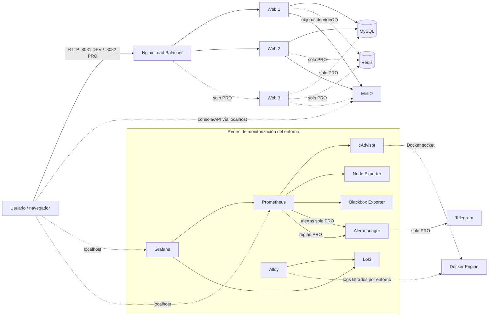

# StreamForge — Infrastructure as Code

StreamForge despliega con Terraform una aplicación web de streaming de vídeo y sus dependencias en contenedores Docker. Los roots independientes `dev` y `pro` reutilizan módulos de infraestructura y difieren en escala, servicios habilitados y puertos publicados.

## Índice

1. [Setup y ejecución del proyecto](#1-setup-y-ejecución-del-proyecto)
2. [Partes del proyecto y arquitectura](#2-partes-del-proyecto-y-arquitectura)
3. [Tests y validación](#3-tests-y-validación)
4. [Funcionamiento de la aplicación](#4-funcionamiento-de-la-aplicación)
5. [Datos, MinIO y persistencia](#5-datos-minio-y-persistencia)
6. [Monitorización, logs y alertas](#6-monitorización-logs-y-alertas)
7. [Redes y políticas de acceso](#7-redes-y-políticas-de-acceso)
8. [Limitaciones y troubleshooting](#8-limitaciones-y-troubleshooting)

---

# 1. Setup y ejecución del proyecto

## 1.1 Prerrequisitos

| Requisito | Uso |
|---|---|
| Git | Clonar el repositorio. |
| Docker Engine y Docker CLI | Ejecutar los contenedores; Docker debe estar iniciado y accesible por el usuario. |
| Terraform `>= 1.5.0` | Inicializar, validar y desplegar los roots. |
| GNU Make | Ejecutar los objetivos del `Makefile`. |
| Bash y `curl` | Ejecutar la demo y hacer comprobaciones HTTP. |
| Python 3 | Ejecutar la utilidad de carga incluida en `scripts/demo/`. |

Terraform instala los providers declarados por el proyecto durante `init`: `kreuzwerker/docker ~> 3.0` y `hashicorp/local ~> 2.5`. Docker Compose no se utiliza ni hay un manifiesto Compose. La aplicación se construye con Node.js 22 dentro de su imagen; Node.js en el host no es necesario para desplegarla. Node.js sí se usa si se ejecuta localmente la utilidad de subida de vídeos.

## 1.2 Descargar y configurar

```bash
git clone https://github.com/zabws3/streamforge-iac.git
cd streamforge-iac

docker info
terraform version
make help
```

Terraform lee las variables de cada entorno desde `terraform/environments/dev/dev.tfvars` o `terraform/environments/pro/pro.tfvars`; también admite variables de entorno `TF_VAR_*`. No hay `.env` ni `.env.example`. Los ficheros `*.tfvars` están ignorados por Git: créalos localmente y no los añadas al repositorio.

Variables sensibles obligatorias:

| Entorno | Variables |
|---|---|
| DEV | `database_password`, `database_root_password`, `minio_password`, `grafana_password`, `session_secret` |
| PRO | Las variables de DEV más `telegram_bot_token` y `telegram_chat_id` |

Rellena cada fichero con valores propios, respetando los nombres y tipos declarados en `terraform/environments/<entorno>/variables.tf`. PRO solo envía notificaciones a Telegram cuando se proporcionan los valores de bot y chat. No incluyas credenciales reales en documentación o control de versiones. Terraform puede almacenar valores sensibles en el state local, por lo que también hay que proteger ese state y las copias de seguridad.

## 1.3 Desplegar DEV

```bash
make dev-init
make dev-validate
make dev-plan
# Revisa el plan antes de confirmar los cambios:
make dev-deploy
```

`make dev-deploy` genera el plan y lo aplica. `make dev-up` también aplica, pero no ofrece el mismo paso explícito de revisión. `make setup` es un alias de `make dev-up`. El estado Terraform de DEV es independiente del de PRO.

## 1.4 Desplegar PRO

Primero completa `terraform/environments/pro/pro.tfvars`, incluidas las credenciales de Telegram si se quieren notificaciones.

```bash
make pro-init
make pro-validate
make pro-plan
# Revisa el plan antes de confirmar los cambios:
make pro-deploy
```

`make pro-deploy` genera y aplica un plan. `make pro-up` inicializa Terraform y aplica directamente. Alertmanager y las reglas de alertas solo forman parte de PRO.

## 1.5 Diferencias de acceso entre entornos

| Servicio | DEV | PRO | Publicación |
|---|---:|---:|---|
| Aplicación mediante Nginx Load Balancer | `http://localhost:8081` | `http://localhost:8082` | Puerto del host |
| MinIO API | `http://localhost:9000` | `http://localhost:9100` | Enlazado a `127.0.0.1` |
| Consola MinIO | `http://localhost:9001` | `http://localhost:9101` | Enlazado a `127.0.0.1` |
| Grafana | `http://localhost:3001` | `http://localhost:3002` | Enlazado a `127.0.0.1` |
| Prometheus | `http://localhost:9090` | `http://localhost:9091` | Enlazado a `127.0.0.1` |

Las credenciales de Grafana y MinIO son las configuradas para el entorno en los ficheros locales de variables. Las réplicas web no publican puertos individuales: se accede a ellas mediante el balanceador.

## 1.6 Comprobar, consultar logs y parar

```bash
# Estado de los contenedores del entorno
docker ps --filter name=dev_
docker ps --filter name=pro_

# Comprobación HTTP de la aplicación a través del balanceador
curl -fsS http://localhost:8081/health
curl -fsS http://localhost:8082/health

# Prometheus: página de targets
curl -fsS http://localhost:9090/targets
curl -fsS http://localhost:9091/targets

# Logs de un contenedor concreto (sustituye el nombre por el que muestre docker ps)
docker logs --tail 100 dev_load_balancer
docker logs --tail 100 pro_load_balancer
```

La demo operativa incluida está fijada a PRO:

```bash
bash demo.sh
```

Su menú permite ejecutar comprobaciones y escenarios; algunas opciones generan carga, reinician servicios o envían una alerta de prueba. Lee las confirmaciones que presenta la demo antes de seleccionar una opción. Hay más información en [DEMO-README.md](./DEMO-README.md).

No existe un objetivo Make de parada que preserve explícitamente los contenedores. Para pararlos sin destruirlos:

```bash
docker ps -q --filter name=dev_ | xargs -r docker stop
docker ps -q --filter name=pro_ | xargs -r docker stop
```

Esto conserva contenedores y volúmenes, pero Terraform puede recrear recursos en una aplicación posterior. `make dev-destroy`, `make pro-destroy` y `make dev-restart` sí destruyen o reconstruyen recursos. Antes de usarlos, revisa el plan y considera que la eliminación de volúmenes implica pérdida de datos persistidos.

## 1.7 Objetivos Make disponibles

`make help` muestra estos objetivos. `init` prepara el root; `validate` valida la configuración; `plan` muestra cambios; `up` aplica directamente y `deploy` genera y aplica un plan.

| Grupo | Objetivos |
|---|---|
| DEV | `dev-init`, `dev-validate`, `dev-plan`, `dev-up`, `dev-deploy`, `dev-destroy`, `dev-output`, `dev-ps`, `dev-logs`, `web-logs`, `lb-logs`, `grafana-logs`, `dev-restart`, `setup` |
| PRO | `pro-init`, `pro-validate`, `pro-plan`, `pro-up`, `pro-deploy`, `pro-destroy`, `pro-output`, `pro-ps` |

`dev-ps` lista todos los contenedores visibles en Docker; `pro-ps` filtra los nombres `pro_`. `dev-logs` consulta Web, balanceador, MySQL y Redis, aunque Redis no se despliega en DEV, por lo que ese último comando puede fallar. `web-logs`, `lb-logs` y `grafana-logs` siguen los logs de contenedores DEV. `dev-restart` destruye DEV y vuelve a aplicar los recursos; no lo uses como simple parada.

---

# 2. Partes del proyecto y arquitectura

## 2.1 Componentes principales

| Componente | Función | Tecnología |
|---|---|---|
| Aplicación Web | Interfaz y endpoints de salud, instancia y streaming de vídeo. | Node.js 22, Express |
| Load Balancer | Distribuye solicitudes entre las réplicas Web. | Nginx |
| Base de datos | Datos relacionales de la aplicación. | MySQL |
| Caché | Caché y almacenamiento de sesiones habilitado en PRO. | Redis |
| Almacenamiento multimedia | API S3 compatible, consola y objetos de vídeo. | MinIO |
| Métricas | Recopila métricas de los servicios y exporters. | Prometheus |
| Dashboard | Consulta métricas y logs. | Grafana |
| Métricas de contenedores | Uso y estado de los contenedores Docker. | cAdvisor |
| Métricas del host | Métricas de sistema, incluidas las de disco. | Node Exporter |
| Sondeos de disponibilidad | Comprueba endpoints HTTP y conexiones de red. | Blackbox Exporter |
| Agente de logs | Descubre y etiqueta logs de contenedores del entorno. | Grafana Alloy |
| Almacenamiento de logs | Recibe y consulta logs. | Loki |
| Alertas y notificaciones | Evalúa reglas y enruta notificaciones Telegram. Solo PRO. | Prometheus, Alertmanager |

No se ha implementado Nginx Exporter. La lista de servicios por entorno se define en los roots Terraform; las diferencias principales se resumen en [la tabla de entornos](#15-diferencias-de-acceso-entre-entornos).

## 2.2 Arquitectura global

El diagrama muestra los servicios y flujos principales. Las redes se crean con prefijo de entorno (`dev_` o `pro_`); DEV no incluye Redis ni el módulo de alertas.



El usuario accede a la aplicación a través del balanceador. Las Web comparten MySQL y MinIO; PRO añade Redis y una tercera réplica. Prometheus consulta exporters y los sondeos Blackbox. Alloy envía logs etiquetados a Loki; Grafana consulta Prometheus y Loki. Las alertas de PRO se enrutan desde Alertmanager a Telegram.

## 2.3 Estructura real de Terraform y del repositorio

```text
.
├── app/
│   ├── Dockerfile
│   ├── package-lock.json
│   ├── package.json
│   ├── public/
│   ├── scripts/
│   └── src/
├── db/
│   └── init.sql
├── media/
├── scripts/
│   └── demo/
│       └── load_test.py
├── terraform/
│   ├── environments/
│   │   ├── dev/
│   │   └── pro/
│   └── modules/
│       ├── alerts/
│       ├── cache/
│       ├── database/
│       ├── load_balancer/
│       ├── monitoring/
│       ├── network/
│       ├── storage/
│       └── web/
├── DEMO-README.md
├── AUDITORIA-TECNICA-STREAMFORGE-P2.md
├── Makefile
├── README.md
├── dash.sh
└── demo.sh
```

Un **root** es la configuración de entrada de Terraform que selecciona providers, variables y módulos para un entorno. `terraform/environments/dev` y `terraform/environments/pro` son roots independientes. Cada uno invoca los módulos reutilizables de red, base de datos, caché, almacenamiento, Web, balanceador y monitorización; el root PRO invoca además `alerts`.

Los módulos encapsulan recursos Docker y exponen outputs para que el root conecte redes, nombres, puertos y dependencias sin duplicar la implementación. Las variables parametrizan el entorno, el número de réplicas, credenciales y opciones de servicios. Los directorios `generated/` contienen configuraciones producidas por Terraform en ejecución y no son módulos fuente.

---

# 3. Tests y validación

## 3.1 Validación Terraform

| Comprobación | Comando | Qué valida |
|---|---|---|
| Formato de todos los archivos Terraform | `terraform fmt -check -recursive terraform` | Que el código está formateado; no modifica archivos. |
| Root DEV | `make dev-validate` | Sintaxis y configuración de Terraform DEV con los providers inicializados. |
| Root PRO | `make pro-validate` | Sintaxis y configuración de Terraform PRO con los providers inicializados. |
| Plan DEV | `make dev-plan` | Cambios propuestos por Terraform, sin aplicarlos. |
| Plan PRO | `make pro-plan` | Cambios propuestos por Terraform, sin aplicarlos. |

`terraform validate` no sustituye a `terraform plan`: validar no comprueba que Docker pueda crear todos los recursos ni que los valores locales produzcan el comportamiento esperado. Revisa siempre el plan antes de desplegar.

## 3.2 Tests de aplicación

No hay suite automatizada de tests de aplicación ni script `test` en `app/package.json`. No se debe ejecutar `npm test` como si estuviese configurado. Hay endpoints de salud y de identificación de instancia que se pueden comprobar con la demo o mediante HTTP; son comprobaciones operativas, no tests unitarios.

La utilidad [scripts/demo/load_test.py](./scripts/demo/load_test.py) genera carga acotada para la demo. No es una suite de tests automatizada.

## 3.3 Tests de infraestructura

`demo.sh` ofrece comprobaciones operativas sobre PRO, incluidas disponibilidad, balanceo, monitorización, logs, MinIO, redes y alertas. Según la opción elegida, algunas pruebas pueden generar carga, reiniciar servicios o emitir notificaciones. No se han ejecutado todas en esta revisión.

| Comprobación | Estado en esta revisión |
|---|---|
| Contenedores esperados y endpoints principales de PRO | Ejecutada mediante la opción de validación general de la demo. |
| Validación de configuración Terraform DEV y PRO | Ejecutada. |
| Formato Terraform y sintaxis de scripts | Ejecutados. |
| `terraform plan` DEV/PRO | Pendiente de ejecución. |
| Failover, persistencia tras reinicio y carga/balanceo | Pendiente de ejecución en esta revisión. |
| Aislamiento de logs DEV/PRO tras aplicar la configuración | Pendiente de comprobación en runtime. |
| Entrega real de alertas a Telegram | Pendiente; la demo detectó Alertmanager, pero no verifica la recepción final del mensaje. |

## 3.4 Resultados y outputs observados

Resultados de comandos ejecutados en el checkout local durante esta revisión:

| Test | Comando | Resultado | Evidencia |
|---|---|---|---|
| Formato Terraform | `terraform fmt -check -recursive terraform` | PASS | Código de salida 0; sin diferencias de formato. |
| Validación DEV | `make dev-validate` | PASS | Terraform mostró `Success! The configuration is valid.` |
| Validación PRO | `make pro-validate` | PASS | Terraform mostró `Success! The configuration is valid.` |
| Sintaxis de la demo | `bash -n demo.sh` | PASS | Código de salida 0. |
| Sintaxis de JavaScript | `node --check app/src/app.js` y `node --check app/scripts/upload-video.js` | PASS | Ambos comandos terminaron con código 0. |
| Sintaxis Python | `python3 -m py_compile scripts/demo/load_test.py` | PASS | Código de salida 0. |
| Integridad del diff | `git diff --check` | PASS | Sin errores de whitespace en los cambios revisados. |
| Validación operativa PRO | `bash demo.sh`, opción 13 (solo lectura) | `21 PASS \| 0 FAIL \| 1 WARNING` | Los 15 contenedores esperados estaban en ejecución; respondieron `/health`, `/instance`, Prometheus, Grafana y MinIO. Warning: Alertmanager está presente, pero la entrega a Telegram no se verificó. |

Los resultados son del entorno disponible al ejecutar la revisión; no garantizan el estado de un despliegue futuro. No se ejecutó `terraform apply` ni `terraform destroy` para documentar estos resultados.

---

# 4. Funcionamiento de la aplicación

## 4.1 Balanceo de carga

Nginx recibe el tráfico de la aplicación y distribuye las solicitudes entre las réplicas configuradas usando el algoritmo round robin predeterminado de un bloque `upstream` (no se configura `least_conn`). DEV despliega dos réplicas Web y PRO tres. La configuración permite reintentar en otra réplica ante errores de conexión, timeout y respuestas HTTP 502, 503 o 504. Las réplicas no publican puertos en el host: el acceso se hace por `localhost:8081` (DEV) o `localhost:8082` (PRO).

El endpoint `/instance` ayuda a identificar qué réplica atendió una solicitud. El comportamiento de distribución y failover se puede observar con las opciones correspondientes de `demo.sh`; estas pruebas no se consideran ejecutadas en esta revisión.

## 4.2 Caché y comprobación de salud

Redis está habilitado únicamente en PRO. La aplicación utiliza MySQL para datos persistentes y Redis para las funciones de caché/sesión configuradas. El endpoint `/health` permite comprobar la salud de la aplicación y sus dependencias configuradas.

## 4.3 Streaming DASH

El reproductor web usa manifiestos MPEG-DASH (`.mpd`) y fragmentos (`.m4s`). La ruta `/video/stream/` sirve estos objetos desde los buckets de MinIO y, si un objeto no está allí, puede recurrir al directorio multimedia local configurado en la aplicación. La ruta también soporta solicitudes de rango para fragmentos de vídeo.

La utilidad `app/scripts/upload-video.js` carga un directorio de vídeo que contiene `manifest.mpd` y fragmentos `.m4s` a MinIO. Consulta su mensaje de uso ejecutando el script con los requisitos de Node y las credenciales de MinIO configuradas; no es necesaria para el despliegue base.

---

# 5. Datos, MinIO y persistencia

MinIO proporciona almacenamiento compatible con S3 para los vídeos. La API y la consola web se publican en puertos distintos para DEV y PRO; en ambos casos se enlazan a la interfaz loopback del host. El directorio `media/` del repositorio también se monta como contenido de solo lectura.

| Datos | Persistencia |
|---|---|
| MySQL | Volumen Docker nombrado; `db/init.sql` se utiliza durante la inicialización de la base de datos. |
| Objetos MinIO | Volumen Docker nombrado. |
| Prometheus, Grafana, Loki y Alloy | Volúmenes de datos de monitorización. |
| Alertmanager | Volumen en PRO. |
| Redis | No tiene volumen persistente configurado. |

Los volúmenes Docker sobreviven a la parada normal de contenedores. Destruir o eliminar un volumen puede borrar los datos asociados; `terraform destroy` no debe tratarse como una operación inocua. La demo incluye comprobaciones de MinIO y persistencia, pero solo se deben considerar verificadas cuando se ejecute la opción correspondiente.

---

# 6. Monitorización, logs y alertas

## 6.1 Métricas y dashboards

Prometheus recopila métricas de cAdvisor, Node Exporter y Blackbox Exporter, además de los targets definidos para cada entorno. Blackbox realiza sondeos de disponibilidad HTTP y TCP; no reemplaza a los exporters de métricas de recursos. Grafana incluye un dashboard de infraestructura con métricas de contenedores y host.

Grafana consulta el Prometheus y Loki del mismo entorno. Los puertos de Grafana y Prometheus están enlazados a `127.0.0.1`, por lo que su publicación está limitada al host local por defecto. Nginx Exporter no está implementado.

PromQL es el lenguaje de consulta de Prometheus. Por ejemplo, el dashboard usa:

```promql
sum(rate(container_cpu_usage_seconds_total{id="/",cpu="total"}[5m]))
  / scalar(machine_cpu_cores) * 100
```

La expresión estima el porcentaje de CPU del host a partir de una ventana de cinco minutos. También se consulta `up{job="cadvisor"}` para revisar el estado de un target. Las consultas completas están en [el dashboard versionado](./terraform/modules/monitoring/grafana/dashboards/streamforge-infrastructure.json).

## 6.2 Logs con Alloy y Loki

Alloy descubre los logs de Docker y los etiqueta con el entorno y el contenedor. Su configuración filtra nombres de contenedor `dev_` o `pro_` y omite los propios contenedores de Alloy y Loki. Cada entorno conserva su propio Loki y sus dashboards filtran por entorno: los logs de DEV no deben aparecer en Grafana PRO, ni a la inversa.

Estas reglas describen la configuración versionada. La separación efectiva en contenedores ya desplegados requiere aplicar los cambios y validar el resultado en runtime. Loki está configurado para aceptar entradas con hasta 72 horas de antigüedad.

LogQL permite seleccionar streams y filtrar sus líneas. El dashboard incluye, entre otras, estas consultas:

```logql
{environment=~".+"}
{environment=~".+"} |= "level=error"
{environment=~".+"} |= "[DASH]" !~ "caller="
```

La etiqueta `environment` permite consultar los logs del datasource de cada entorno; los filtros por texto muestran errores o eventos del streaming DASH.

## 6.3 Alertas y Telegram

Alertmanager, las reglas Prometheus y el envío a Telegram se despliegan únicamente en PRO. Las reglas cubren disponibilidad de servicios, estado de contenedores, targets y uso elevado de CPU o memoria. Los umbrales de recursos se parametrizan mediante variables Terraform.

Umbrales por defecto de PRO (se pueden parametrizar):

| Señal | Warning | Crítica |
|---|---:|---:|
| CPU por contenedor | 80% durante 10 min | 95% durante 5 min |
| Memoria por contenedor | 85% durante 10 min | 95% durante 5 min |
| Uso del disco raíz del host | 85% durante 5 min | 95% durante 2 min |

El token se monta como fichero en el contenedor de Alertmanager; el chat ID se utiliza en la configuración generada. Configura ambos valores localmente en las variables de PRO y no los publiques. La presencia de Alertmanager no demuestra que Telegram haya recibido un mensaje: hay que realizar una prueba de entrega con acceso al chat configurado.

---

# 7. Redes y políticas de acceso

Terraform crea redes Docker separadas por entorno y asigna los servicios según su función:

| Red | Propósito |
|---|---|
| `frontend` | Conectividad entre el balanceador y la aplicación Web. |
| `backend` | Comunicación interna de la aplicación con MySQL y, en PRO, Redis; es una red interna. |
| `monitoring` | Comunicación entre Prometheus, exporters, Alloy, Loki y Grafana dentro del entorno; es interna. |
| `host_storage` | Bridge dedicado al contenedor MinIO para la publicación de sus puertos en el host; la aplicación se comunica con MinIO por `backend`. |
| `host_monitoring` | Conecta Prometheus y Grafana a la interfaz publicada en el host para su acceso local. |

Los nombres reales llevan prefijo de entorno (por ejemplo, `dev_` y `pro_`) para que las redes y los servicios no se mezclen. Los puertos publicados no sustituyen a la pertenencia a redes: cada servicio necesita estar en la red adecuada para comunicarse internamente. Las redes `backend` y `monitoring` restringen la conectividad externa mediante su configuración `internal`. `host_storage` y `host_monitoring` son bridges dedicados con masquerade desactivado; eso controla el NAT de salida del contenedor, no el acceso entrante desde el host. La exposición desde el host la determina el puerto publicado y su IP de bind (en MinIO, Prometheus y Grafana es `127.0.0.1`); la red por sí sola no identifica ni autoriza equipos concretos.

---

# 8. Limitaciones y troubleshooting

## Limitaciones conocidas

- No hay Docker Compose ni `.env.example`; el despliegue se configura mediante Terraform y variables locales.
- No existe suite automatizada de tests unitarios/de integración de la aplicación.
- Nginx Exporter no está implementado.
- La entrega a Telegram requiere credenciales válidas y comprobación en el chat receptor.
- DEV y PRO son deployments locales administrados por roots Terraform separados; no son entornos remotos con state compartido configurado aquí.
- No hay un objetivo Make de parada que garantice conservar recursos; los objetivos `destroy` eliminan recursos y pueden afectar datos persistidos.
- Node Exporter y cAdvisor exponen métricas del host y de Docker, respectivamente; revisa los mounts y permisos de Docker antes de desplegar en una máquina compartida.

## Problemas habituales

| Síntoma | Comprobación |
|---|---|
| Terraform no puede conectar con Docker | Comprueba `docker info`, que Docker esté iniciado y que el usuario tenga permiso para acceder al daemon. |
| Fallo en `terraform validate` por variables o ficheros | Comprueba que ejecutas el objetivo correcto y que el fichero local `dev.tfvars` o `pro.tfvars` tiene las variables requeridas con nombres y tipos correctos. |
| Un puerto no está accesible | Comprueba los puertos de la tabla de [acceso por entorno](#15-diferencias-de-acceso-entre-entornos), que el contenedor esté en ejecución y que no exista otro proceso usando el puerto. |
| Web no disponible | Consulta `docker ps` y los logs de `dev_load_balancer`/`pro_load_balancer` y de las réplicas Web correspondientes. |
| Dashboard sin datos | Revisa que Prometheus tenga targets activos y que estás abriendo el Grafana del mismo entorno que el deployment consultado. |
| No aparecen logs recientes | Comprueba los logs de Alloy y Loki del entorno y las etiquetas de entorno/contenedor en Grafana. |
| No llega una alerta Telegram | Comprueba el token y chat ID locales de PRO, Alertmanager y el estado de la alerta; una alerta resuelta o no disparada no genera necesariamente una notificación nueva. |

Comandos Make disponibles: `make help`. Para ver los comandos de demo, ejecuta `bash demo.sh` y consulta [DEMO-README.md](./DEMO-README.md).
